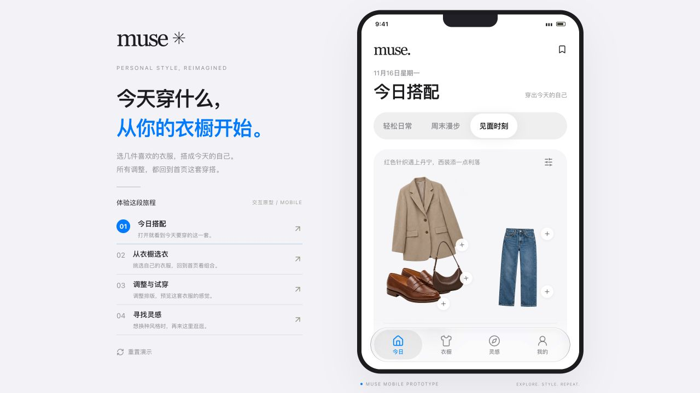

# MUSE · 从衣橱开始的今日搭配

面向手机的穿搭应用原型，使用 React、TypeScript、Vite 和 Lenso UI。

**[打开公开演示](https://muse-mobile-wardrobe.gentle-dell-0151.chatgpt.site)** · **[技术 SPEC](docs/SPEC.md)** · **[团队交接](docs/TEAM_HANDOFF.md)** · **[API 契约](docs/contracts/openapi.json)**



## 当前能体验什么

- 今日搭配：轻松日常、周末漫步、见面时刻各自拥有不同推荐，支持自由换衣、独立保存编辑和恢复推荐。
- 衣橱：分类浏览、添加衣物演示、挑选单品并带回今日搭配。
- 搭配：滑动换衣、锁定单件、自由画布、保存组合。
- 灵感与推荐：风格探索、待购单品与已有衣服组合的交互演示。
- 试穿：明确标记的预生成示例；保留真实试穿接入位置。

当前页面使用浏览器本地数据。**真实登录、云端数据库、Qoder/Seedream 联调和商品服务尚待实现**。`server/reference/` 是通过离线测试的协议参考，不是可部署的业务服务器。试穿图不是尺寸判断依据。

## 本地启动

需要 Node.js 22.18+（推荐使用 `.nvmrc` 指定的 Node 22）。首次克隆后，在仓库根目录运行：

```sh
npm ci
npm run dev -- --port 5179
```

打开 http://localhost:5179 。前端演示无需任何 API Key。手机体验使用上方 HTTPS 公开演示地址；手机上的 localhost 指向手机本身。

```sh
npm test        # 场景状态、Qoder 协议与调用脚本的离线测试
npm run build  # TypeScript 检查和生产构建
npm run check  # 顺序执行测试和构建
npm run preview
```

## 工程目录

```text
src/                       手机前端和本地状态
public/                    图片、主屏幕图标、素材许可与交接下载包
docs/SPEC.md               产品与技术共同基线
docs/contracts/            OpenAPI 3.1 接口合同（待实现）
docs/SEEDREAM_TRYON.md      人物图 + 衣物图的图片试穿方案
server/reference/          Qoder 协议参考和 mock 测试
skills/qoder-cloud-agent/  可移植的开发 skill、API 样例、调用脚本
.github/workflows/         自动测试和构建
.env.example               后续业务后端的配置模板，无真实密钥
```

## 接入路线与分工

移动 Web/PWA → 业务 API → PostgreSQL / 私有图片存储 / 后台 Worker。Qoder 负责搭配与 Custom Tools 编排，长期记忆使用原生 Memory / Dream。Seedream 负责首发图片试穿；Decart 实时视频为后续能力。

1. 前端按 [OpenAPI](docs/contracts/openapi.json) 实现 API client 和成功/失败/取消状态。
2. 后端实现用户身份、衣橱/草稿 CRUD、资源归属、持久任务和图片存储。
3. Qoder 接入者从 [SKILL.md](skills/qoder-cloud-agent/SKILL.md) 开始，先跑两项最小工具的离线闭环，再使用自己的开发资源联调。
4. 图片接入者按 [Seedream 规格](docs/SEEDREAM_TRYON.md) 验证参考图、生成结果转存、未知请求状态和成本。

全部任务边界、配置和验收要求见 [团队交接](docs/TEAM_HANDOFF.md)。早期 `src/integrations/contracts.ts` 已标为历史草案；新接口以 OpenAPI 为准。

## 使用 Qoder skill

将整个 `skills/qoder-cloud-agent/` 文件夹复制到支持的工具技能目录，或直接让开发 Agent 读取其 `SKILL.md`。Codex 的用户技能目录为 `~/.codex/skills/`。

```sh
node skills/qoder-cloud-agent/scripts/request.mjs request --method GET --path /agents
```

默认仅预览请求，不读取 token、不联网。显式添加 `--execute` 才会使用服务端 `QODER_ACCESS_TOKEN` 调用 API。不要把凭据发给模型、写到前端或提交进 Git。

## 协作与部署

从 `main` 新建功能分支，通过 Pull Request 合并；提交前运行 `npm run check`。GitHub Actions 执行相同检查，不调用付费模型、不自动部署。

当前 `.openai/hosting.json` 指向已有 Sites 演示项目；GitHub 推送不会自动更新公开站点。正式业务后端的部署方案见 SPEC；不要把静态演示站误认为已部署数据库和 Worker。

## 许可与素材

第三方组件和素材说明保留在 [public/licenses](public/licenses/README.txt)。本仓库没有授予自有代码和素材额外的开源许可；团队若要公开发布开源版本，应先确认自有代码授权与素材使用范围。
