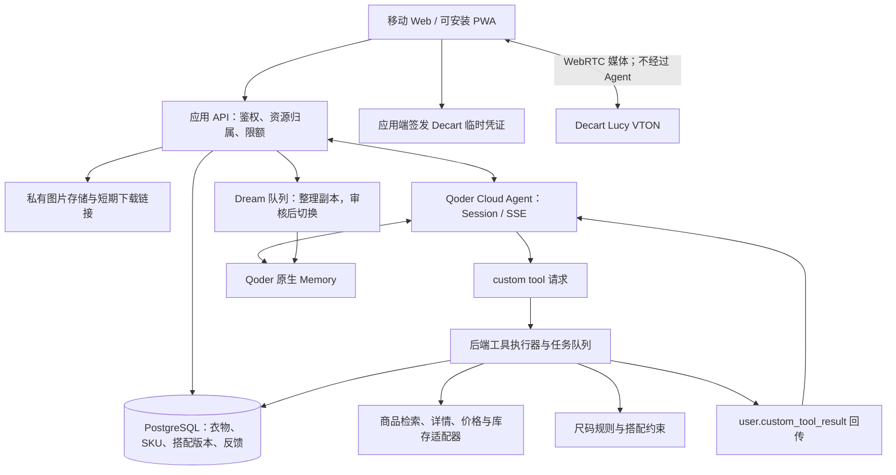

# MUSE 手机端原型与后续接入架构

本次交付是 React/TypeScript 手机 Web 原型。商品、价格、推荐和试衣画面均为演示数据；浏览器本地状态不等于云端账户。未创建 Qoder Agent、未调用商品服务或 Decart 付费模型，也没有真实下单。

## 从原型走向产品

初期可以使用一个 Node/TypeScript 应用 API、一个后台 Worker、PostgreSQL 和对象存储，不需要先拆微服务。保留现有 Vite 前端；上线时由 HTTPS 网关把 `/api/*` 路由到后端。本次静态 Sites 只提供前端，不会自动产生这些 API。

## 核心数据和状态

- `Garment`：用户已有衣物及图片、属性、来源、用户确认记录。`ProductVariant`：候选商品的商家、颜色、SKU、价格与获取时间。二者不能混为一张“已拥有”列表。
- `OutfitDraft`：同一业务任务的持久 ID、revision、各位置的衣物引用、锁定状态、灵感、场合和可选预算。发现、衣橱、推荐与试衣都使用同一个草稿。用户的局部修改创建新 revision，不重置整套。
- `OutfitVersion`、`TryOnSession`：试衣保存当时的草稿版本、选中商品与模型版本，避免更换商品后把旧结果误认为新商品结果。
- `WearFeedback`：区分收藏、愿意尝试、真实穿过和舒适感，只有真实确认的反馈才能作为实穿经验。`PurchaseIntent` 不是实际订单；用户确认收到商品才进入已有衣橱。
- 本地原型状态保留在专属 storage key。生产版用服务端账户与数据库；上传照片使用私有对象存储、签名链接和删除生命周期，体量较大的本地图片使用 IndexedDB，不塞满 localStorage。

## Qoder：先核对契约，再接入

1. 后端维护 `app user → memory_store_id`、`outfit draft → Qoder session_id` 映射。一个草稿的补充消息复用 Session，独立任务另建 Session。绑定 Agent 版本、Environment 和该用户的 Memory Store。
2. `POST /api/v1/cloud/sessions` 创建；`POST /api/v1/cloud/sessions/{id}/events` 发送 user.message；从 `/events/stream` 消费 SSE，前端只接应用侧归一化进度和结果。
3. 收到 `agent.custom_tool_use` 后，业务后端校验身份、工具名和参数，执行工具，再用调用事件 ID 作为 custom_tool_use_id 回传 `user.custom_tool_result`。平台不会替应用执行 Custom Tool。
4. 工具建议：read_wardrobe、search_products、get_product_details、build_outfit_candidates、evaluate_outfit_constraints、calculate_fit、save_outfit、record_wear_feedback。只让工具读取当前用户有权限的记录；user_id 由后端绑定，不能信任模型传参。
5. 推荐中的主观审美由模型组织候选并解释；预算加总、SKU 价格、去重、尺寸单位转换与规则比较由代码执行。保留来源、采集时间与未知项，不能生成不存在的商品链接、价格或热度。
6. 事件按 ID 合并；断线恢复时补历史，不以流关闭或 agent.message 单独认定完成。写操作超时先查历史，保留 unconfirmed 状态。工具执行器用数据库领取记录避免多实例重复执行，先持久化结果再回传。

平台 Key 只存服务端。原生 Memory 保存偏好和经验，数据库保存精确衣物、尺码及原始反馈。Dream 克隆输入仓库并在输出副本整理，完成后必须读取 outputs、补齐期间新反馈并切换用户当前仓库指针。显式指定同一用户的 Session，验证跨用户边界。单身份/工作空间的活跃 Dream 有并发限制，使用队列。

## Decart 接入位置

`src/integrations/decart.ts` 是禁用云调用的 transport 接缝，默认 mode=demo。提供 enabled 开关、SDK port、临时 token fetch、原生相机采集、完整条件更新和 stop 清理。它不是已经验证的真实 SDK/云集成。

接入时安装并锁定官方 `@decartai/sdk`，将 port 绑定到 `createDecartClient({ apiKeyProvider })`、`models.realtime(modelId)` 和 `client.realtime.connect(...)`。后端实现 `POST /api/tryon/client-token`，验证用户/额度后调用 SDK 的 `tokens.create`，限定模型、网页 origin、TTL 和 maxSessionDuration。临时凭证仅进入当前连接内存，不进提示词、永久日志或 localStorage。凭证过期只限制新连接，必须另设 maxSessionDuration 控制持续使用。

用户点击开始后才请求摄像头；麦克风不需要。WebRTC 直接连接 Decart，不把逐帧视频放进 Qoder 或普通 API 请求。每次切换条件同时提交 prompt 与 image。离开页面、取消连接和失败时关闭相机轨道。接入后验证不同网络、遮挡、移动设备温升、参考服装细节和多件叠穿；不承诺尚未实测的整套精准换装。实时 VTON 是视频接口，静态照片试衣另行核对。

外观预览不能用于推断真实尺码；身体尺寸和参考衣物、商品尺码表、穿后反馈独立参与选码。

## 应用 API 提案（并非上游 API）

| 入口 | 用途 |
|---|---|
| GET /api/integrations/status | 返回真实能力开关；未配置时保留示例模式 |
| POST /api/conversations | 为业务草稿建立或复用云会话 |
| POST /api/conversations/:id/messages | 提交消息、记录写入意图 |
| GET /api/conversations/:id/events | 应用侧 SSE：进度、结果、可恢复错误 |
| POST /api/recommendations | 结合风格、衣橱、场合、可选预算检索真实商品 |
| POST /api/outfits | 带 revision 保存方案，冲突时提示保留或合并 |
| POST /api/fit-feedback | 保存用户确认的原始反馈并入记忆队列 |
| POST /api/tryon/client-token | 鉴权、限额、签发 Decart 临时凭证 |

## 官方契约来源（核对日期：2026-11-15）

- [Qoder 工具与 Custom Tool](https://docs.qoder.cn/cloud-agents/agent-tools)
- [创建 Session](https://docs.qoder.cn/cloud-agents/sessions-create)
- [发送事件](https://docs.qoder.cn/cloud-agents/api/sessions/events/send)
- [SSE](https://docs.qoder.cn/cloud-agents/api/sessions/events/overview)
- [原生 Memory](https://docs.qoder.cn/cloud-agents/memory-stores)
- [Dream](https://docs.qoder.cn/cloud-agents/dreams)
- [Decart VTON](https://platform.decart.ai/models/lucy-vton)
- [Decart 临时凭证](https://docs.platform.decart.ai/getting-started/client-tokens)
