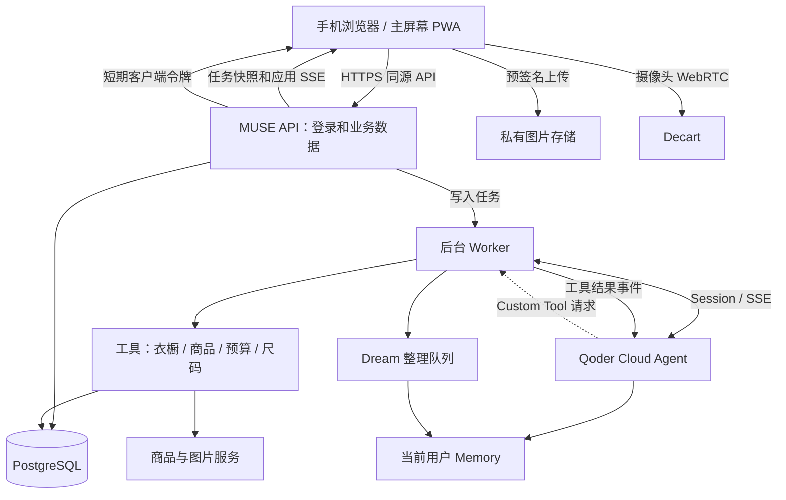
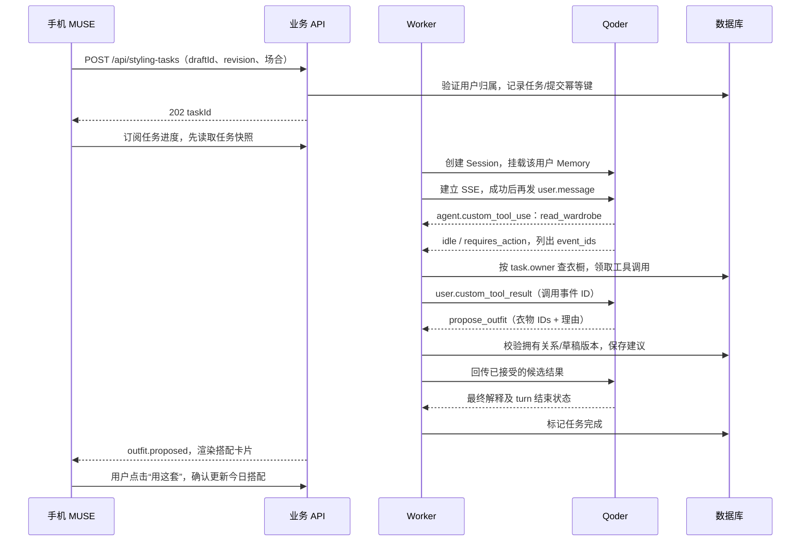

# MUSE：手机使用与 Qoder Cloud Agent 实施方案

更新：2026-11-16。本文区分已实现原型、已验证协议参考和待建设生产服务。决策依据是现有 React 项目、手机端衣橱/搭配/推荐/试穿流程，以及 Qoder 原生 Memory + Dream；不用 OpenViking。

## 1. 第一版选什么技术

**第一版：React + Lenso UI 的可安装移动 Web（PWA）＋ Node.js 业务后端＋ PostgreSQL＋私有对象存储＋ Qoder Managed API。**

Lenso 负责界面控件，不负责登录、数据库、AI 调用或 App 打包。第一版保留现有 Vite 工程。上线时提供一个 HTTPS 域名，前端和 `/api/*` 同源。无需先重写成 SwiftUI，也无需让用户安装 Qoder。

| 部分 | 具体选择 | 负责什么 |
|---|---|---|
| 手机界面 | React/TypeScript + Lenso UI | 今日搭配、衣橱、灵感、推荐、试衣；manifest、主屏幕图标、安全区 |
| 业务 API | Node.js/TypeScript + Fastify | 登录、用户归属、衣物与搭配 CRUD、任务提交、前端事件流 |
| 后台 Worker | 同一代码库的独立进程 | 消费 Qoder 事件、执行 Custom Tools、图片任务、Memory/Dream 整理 |
| 数据库 | PostgreSQL | 精确业务事实、任务状态、事件游标、幂等记录；初期也可作持久任务队列 |
| 图片 | 私有 OSS/S3 兼容存储 | 原图、衣物抠图、生成结果；数据库只存对象 ID 与元数据 |
| 智能决策 | Qoder Managed Agent | 理解场合、组织搭配候选、按工具证据解释推荐 |
| 长期记忆 | Qoder Memory Store + Dream | 已确认偏好、穿着经验及其整理 |
| 实时试穿 | Decart 官方 SDK/WebRTC | 直接传输视频；后端签短期令牌，Qoder 不处理视频流 |

首次部署可以是一台云服务器运行 HTTPS 网关、API 和 Worker，数据库可同机用于小规模演示，图片独立存 OSS。面向正式用户时，将数据库换成有备份的托管 PostgreSQL。这里不预估未核实的服务价格。



## 2. 手机怎么使用，现场怎么演示

### 现在：本机原型预览

电脑运行 `npm run dev -- --host 0.0.0.0 --port 5179`，手机与电脑处于可以互访的同一 Wi-Fi，手机打开 `http://电脑局域网IP:5179/`。`localhost` 在手机上指手机本身，所以不能把电脑的 localhost 链接直接发给手机。

局域网 HTTP 适合体验选衣、保存和演示画面。它不是正式部署，也不适合验证摄像头 WebRTC：手机浏览器的 `getUserMedia()` 要求安全上下文。校园/公司 Wi-Fi 若启用设备隔离，即使同一 Wi-Fi 也可能无法访问；可以改用允许互访的测试网络，或用正式 HTTPS 演示站。

### 给老师/同学的演示：固定 HTTPS 演示站

1. 构建静态前端，部署到固定域名。只演示前端时无需 Qoder 密钥。
2. 二维码编码这个 HTTPS 地址，手机扫码后在系统浏览器打开；不要默认微信内置浏览器具备同样的相机/WebRTC行为。
3. iPhone 在 Safari 分享菜单选择“添加到主屏幕”；Android 在支持的浏览器菜单选择“安装应用”或“添加到主屏幕”。浏览器版本不同，菜单名称可能略有不同。
4. 从主屏幕图标启动为独立窗口。PWA 不是从 App Store 下载的原生应用；添加到主屏幕也不代表 AI 可离线运行。
5. 答辩时手机投屏到电脑/投影，直接走“首页点衣服→衣橱替换→确认今日搭配→试穿”。准备明确标记的录制/示例试穿作为网络失败备用。

手机实时试穿必须额外验收 HTTPS、摄像头授权、Safari/Android Chrome、目标网络到 Decart 的可达性及手机温升。本次没有在真实手机或真实 Decart 账户上验收。

此前 Sites 地址是私有预览，需要对应 ChatGPT 账号登录，不能当成同学无需登录即可访问的正式用户应用；本次也未将本地新版发布到该地址。

### 后续需要商店 App 时

可以评估 Capacitor 将现有 Web 前端包装为 iOS/Android 项目，补上原生权限、相册、状态栏、键盘、安全区和生命周期处理。相机/WebRTC仍需分别测试，不能假定浏览器通过等于 WebView 通过。上架还需要签名、开发者账号和商店审核，不是生成安装包就完成。

依据：[PWA 安装](https://developer.mozilla.org/en-US/docs/Web/Progressive_web_apps/Guides/Making_PWAs_installable)、[摄像头安全上下文](https://developer.mozilla.org/en-US/docs/Web/API/MediaDevices/getUserMedia)、[Capacitor](https://capacitorjs.com/docs)。

## 3. 哪些操作需要 Agent

| 用户操作 | 执行路径 | 为什么 |
|---|---|---|
| 浏览衣橱、点衣换款、拖动搭配 | 前端即时更新，按需读写 API | 不需要等待推理，也不应消耗 Agent 费用 |
| 保存“今天穿这套”、删除衣物 | 应用 API + 数据库 | 结果可确认、可撤销，归属清楚 |
| 上传衣物 | 图片上传 + 异步识别/抠图任务 + 用户确认 | 图片识别结果先是建议，确认后才成为衣物属性 |
| “用我现有衣服搭一套” | Qoder + read_wardrobe + propose_outfit | 需要理解偏好与场合；结果是可渲染的衣物引用 |
| “预算内补一件” | Qoder + 商品工具 + 代码校验 | 价格、库存和预算不能靠模型编造 |
| 风格/冬季趋势推荐 | 有日期来源的趋势资料 + Qoder 解释 | 区分常见风格建议与实时热度，避免虚构流行榜 |
| 点击实时试穿 | Decart transport + 后端短期令牌 | 不需要新开 Agent loop，视频直连模型服务 |
| “这条裤子腰紧”反馈 | 先保存原始反馈，再写 Memory，后台 Dream | 反馈必须可追溯，不让摘要覆盖事实 |

首屏直接读已保存的今日搭配或最近建议。进入首页不自动创建付费云会话。AI 建议作为可主动触发的操作，生成期间仍可继续手动搭配。

## 4. Qoder 资源怎么建立

用 **Managed API**，中国站前缀是 `https://api.qoder.com.cn/api/v1/cloud`。不要混用 Forward API 的 Identity/Template 请求结构，也不要把 Qoder 编程助手客户端当作 App 后端。

开发调试可用 PAT；服务端正式集成建议用服务账号 SA Key 换取 SAT，仅请求需要的 `qca.access`。SA Key 不能直接当作业务 Bearer token，且全局站/中国站凭证、资源与 Base URL 必须一致。官方 TypeScript SDK 为 `qca-sdk`，使用 `ManagedClient`；中国站须显式配置 CN Base URL，服务账号凭证使用 `region: 'cn'`。

一次性配置 Agent 和 cloud Environment。Agent 配置系统指令与工具 schema；Environment 是 Qoder 执行环境，**不是我们的 App 托管服务器**。不需要为了后端 Custom Tools 把整个前端工程放进 Qoder 环境。

建议映射：

| 应用对象 | Qoder 资源 | 策略 |
|---|---|---|
| 搭配助手版本 | Agent ID + version | 可共享配置，Session 固定版本，升级显式迁移 |
| 用户偏好档案 | Memory Store | 每用户独立；由应用数据库保存当前 Store ID |
| 一次搭配/购买咨询任务 | Session | 同一任务补充问题复用；新任务新建；不让所有用户共享一个会话 |
| 执行配置 | cloud Environment | 配置可复用；不等于用户数据可混用 |

搭配 Agent 第一阶段只启用内置 `Read` 读取挂载的个人记忆，以及两个 Custom Tools：`read_wardrobe`、`propose_outfit`。商品推荐能力后续增量添加。不默认开启 Bash、任意浏览器操作或购买行为。

依据：[认证](https://docs.qoder.cn/cloud-agents/api-authentication)、[SDK](https://docs.qoder.cn/cloud-agents/sdk/typescript)、[创建 Agent](https://docs.qoder.cn/cloud-agents/agents-create)、[创建 Environment](https://docs.qoder.cn/cloud-agents/environments-create)。

## 5. 一次“帮我搭一套”的完整调用



创建 Session 的请求体（示例 ID 必须替换为后端持有的真实资源）：

```json
{
  "agent": { "type": "agent", "id": "agent_...", "version": 1 },
  "environment_id": "env_...",
  "title": "MUSE 今日搭配",
  "metadata": { "muse_task_id": "task_..." },
  "budget": { "type": "limit", "max_credit_cost": "10.00" },
  "resources": [{
    "type": "memory_store",
    "memory_store_id": "memstore_...",
    "access": "read_only",
    "instructions": "Read confirmed preferences and wear experience. Exact wardrobe facts come from tools."
  }]
}
```

`10.00` 仅是预算字段的演示值，不是推荐成本或人民币价格；上线前按账户计费和实际测试设置。

消息发送到 `POST /sessions/{id}/events`，`content` 用数组：

```json
{"events":[{"type":"user.message","content":[{"type":"text","text":"用现有衣服搭配一套适合明天上课的穿搭，保留当前选择的牛仔裤。"}]}]}
```

收到并确认待处理工具调用后，由 **MUSE 后端** 执行。文档的“Client-side”是相对 Qoder 服务端而言，不意味着必须把数据库操作放在手机上：

```json
{"events":[{"type":"user.custom_tool_result","custom_tool_use_id":"evt_工具调用事件ID","content":[{"type":"text","text":"{\"garments\":[{\"id\":\"g_1\",\"category\":\"top\",\"name\":\"白色针织衫\"}]}"}],"is_error":false}]}
```

该结果回传同一 Session。不能用 `user.tool_confirmation` 代替 Custom Tool 结果；后者只是另一种内置/MCP 工具审批事件。

工具输出必须结构化。`propose_outfit` 提交 garment IDs、理由；后端从数据库补出图片，不让模型随意生成图片 URL。服务端校验后再推给前端，保存今日搭配由用户明确操作触发。用户在 AI 运行期间改了草稿时，比较 `draftRevision`，将旧建议显示为可选择的候选，不能覆盖新编辑。

依据：[创建 Session](https://docs.qoder.cn/cloud-agents/sessions-create)、[发送事件](https://docs.qoder.cn/cloud-agents/api/sessions/events/send)、[工具配置](https://docs.qoder.cn/cloud-agents/agent-tools)、[Pending Action](https://docs.qoder.cn/cloud-agents/permission-policies)。

## 6. 手机断线和后台运行怎么处理

手机切后台会暂停网页运行，不能依赖手机承担 Agent 工具执行循环。任务始终在后端 Worker 中进行，手机仅订阅进度。回到前台先 GET 任务快照，再恢复应用事件流。

Qoder 当前规则：不带 `Last-Event-ID` 的新 SSE 从尾部开始，**不会回放历史**。因此先建立流再触发消息；进程重启、断线或缺口时，分页查询历史并按 ID 合并。Qoder 文档没有要求 Ark 式 `: ready` 握手，不能把另一个平台的规则照搬过来。

`agent.message` 到达或 SSE 关闭都不代表任务成功。根据 Session 的状态事件判定：`requires_action` 等待工具，`rescheduled` 等平台恢复，`end_turn` 表示 turn 结束但还要排除用户取消并验证候选，未知状态保留 unknown。不要用子线程 idle 结束整个任务。

写操作超时保留 `unconfirmed`，先查询历史，不循环重发。工具调用通过数据库唯一键领取，结果先存库再回传。Agent 运行中新的用户消息可能返回 409，应在 UI 排队或明确取消当前任务。

应用侧采用同源 HttpOnly 登录 cookie；SSE 返回归一化的 `task.progress`、`outfit.proposed`、`task.completed`、`task.failed`。不要把平台令牌、上游完整日志和内部堆栈传给浏览器。退出账号取消该用户的前端订阅。

依据：[SSE 变更公告](https://docs.qoder.cn/cloud-agents/sse-initial-connection-behavior-change)、[SSE 契约](https://docs.qoder.cn/cloud-agents/api/sessions/events/overview)、[Session 生命周期](https://docs.qoder.cn/cloud-agents/sessions)。

## 7. Memory 和 Dream 如何成为真正的个人化

采用用户指定的 Qoder 原生能力，不引入 OpenViking。

- PostgreSQL 保存事实：有哪些衣服、精确尺码、原始反馈、商品价格及抓取时间。
- Memory 保存可读的长期偏好与经验，例如 `preferences/profile.md`、`wear-feedback/{feedbackId}.md`，保留来源和时间。
- 搭配 Session 默认只读挂载当前 Memory；用户确认的反馈由后端写入。这样一句随口的尝试不会被模型直接当作永久偏好。
- 用户确认“穿过、合适/不合适”后先落数据库，再将去重过的反馈同步到 Memory。收藏、虚拟试衣和真实穿过分别记录。

Dream 是后台整理任务，不是每发一句话就自动获得的“记忆升级”。建议有新增反馈时按批次触发，不占用用户的实时等待路径：

```json
{
  "inputs": [
    { "type": "memory_store", "memory_store_id": "memstore_当前用户" },
    { "type": "sessions", "session_ids": ["sess_属于该用户的已完成会话"] }
  ],
  "instructions": "整理已确认偏好和真实穿着反馈，保留来源、时间和不确定性，不将虚拟试穿当作尺码证据。"
}
```

后端调用 `POST /dreams`，轮询 `GET /dreams/{id}`。它会克隆输入仓库，整理结果写入**输出副本**，不会原地更新。完成后核对 `outputs[].memory_store_id` 和内容；补齐 Dream 运行期间新增反馈，再以数据库版本比较切换用户当前 Store 指针。第一版可只在用户无活跃任务时提升输出，并让下一次新 Session 使用新 Store。旧 Session 不会自动换挂载。

同一身份在同一工作空间只能有一个活跃 Dream，因此使用队列串行调度。显式传入同一用户的 Session 列表仍不能替代访问控制；生产上线要验证 Dream 的回顾范围。需要平台级租户隔离时用独立业务空间及服务账号，不向共享凭据的沙箱注入数据库/平台密钥。

用户删除偏好应同步处理事实记录、当前 Memory 和仍保留的历史版本内容；不能只删前端卡片。

依据：[Memory](https://docs.qoder.cn/cloud-agents/memory-stores)、[Dream](https://docs.qoder.cn/cloud-agents/dreams)、[创建 Dream](https://docs.qoder.cn/cloud-agents/create-a-dream)、[业务空间](https://docs.qoder.cn/cloud-agents/workspaces)。

## 8. 商品推荐和 Decart 的接入顺序

先把已有衣服搭配跑通，再接一个有权限的商品数据提供方，不同时接很多电商平台。商品服务需真实提供稳定 ID、图片、颜色、SKU、价格、库存/未知状态、来源链接及采集时间；第三方接口能否拿到尺码表必须实测，不能从演示截图推定覆盖率。

后续增加 `search_products`、`get_product_details`、`evaluate_purchase`、`calculate_fit`。新增成本以分为整数计算，SKU 去重，超预算过滤。所谓“能搭多少已有衣服”应给出实际候选组合和计算规则，区分“匹配单品数”和“完整搭配套数”，不能用同一个夸大的数字代替。

Decart 路径：用户点试穿 → 在 HTTPS 下授权摄像头 → 后端 `/api/tryon/client-token` 验证身份/额度 → 用永久 Key 创建短期令牌 → 浏览器使用令牌连接 Decart WebRTC。令牌限定模型、origin、TTL 与 `maxSessionDuration`；令牌过期不会自动断开已有连接，所以会话时长也要限制。离开试穿页关闭轨道和连接。

逐帧视频不通过 Qoder，不在普通后端 API 中转。Qoder 可帮助准备衣物描述或选择参考图；具体模型支持的服装类别、多件叠穿、静态照片模式与网络可达性仍需真机实测。生成的外观图不用于测尺码。

依据：[Decart 客户端令牌](https://docs.platform.decart.ai/getting-started/client-tokens)。项目接缝：`src/integrations/decart.ts`。

## 9. 要实现的应用 API 和表

下面是 **MUSE 自己的 API 设计**，不是 Qoder 上游地址，也不是已经实现的路由：

| API | 行为 |
|---|---|
| POST /api/auth/* | 登录换应用会话，使用已有可信身份服务或手机号验证码供应商 |
| GET/POST /api/garments | 读取/新增当前用户衣物，查询与写入始终带 owner |
| POST /api/uploads | 返回有大小/类型限制的预签名上传信息 |
| POST /api/outfits，PATCH /api/outfits/:id | 保存/修改搭配，校验 revision 冲突 |
| POST /api/styling-tasks | 校验草稿和幂等键，202 返回 taskId |
| GET /api/styling-tasks/:id | 返回持久任务快照与已验证建议 |
| GET /api/styling-tasks/:id/events | 返回应用事件流，独立于 Qoder SSE |
| POST /api/styling-tasks/:id/cancel | 标记取消意图并调用云端 cancel，等待实际状态 |
| POST /api/wear-feedback | 保存确认反馈，进入 Memory 同步队列 |
| POST /api/tryon/client-token | 鉴权/限额后签发短期 Decart token |

核心表：`users`、`garments`、`outfit_drafts`、`outfit_versions`、`styling_tasks`、`agent_sessions`、`agent_events`、`tool_calls`、`wear_feedback`、`memory_bindings`、`dream_jobs`。`agent_events` 唯一 `(session_id,event_id)`；`tool_calls` 同样唯一；`styling_tasks` 对 `(owner_id,idempotency_key)` 唯一。账单记录与用户额度另存，不能把 Session 累计 usage 多次相加。

## 10. 开发里程碑与验收

| 阶段 | 可交付结果 | 验收条件 |
|---|---|---|
| A 手机界面 | Lenso 控件 + PWA 基础 | 真实组件、360/390px 可用；选择替换/取消/保存/返回不丢数据 |
| B 真实衣橱 | 登录、图片上传、衣物与搭配 CRUD、HTTPS 站 | 同一账户跨设备一致；两个用户相互不可读 |
| C Qoder 最小闭环 | 固定 Agent、每任务 Session、read_wardrobe/propose_outfit | 建议引用真实衣物；手机切后台再回来结果仍在；重复事件不重复执行 |
| D 个人记忆 | Memory 写入、Dream 队列与副本切换 | 新会话记住已确认偏好，删除与冲突可追溯，不串用户 |
| E 购买与试穿 | 一个商品提供方 + Decart 真机链路 | 预算可核算，来源可点击，试穿授权/退出/失败恢复正确 |

每个 AI 任务记录首个反馈时间、总耗时、工具耗时、失败率与 Qoder credits。只有真实测过后才能承诺延迟和付费额度；若冷启动/长任务影响体验，采用后台预生成、缓存结果或调整触发点，不让每次手动换衣等待云端 Agent。

**本次实际状态：**Lenso 前端已由 subagent 实施并通过生产构建；主 agent 验证了 360/390px 布局、单件替换、整套取消/应用、保存后刷新与生产版选衣。`server/reference/` 提供已测试的协议参考（8 项测试），不是完整业务后端；Qoder、商品 API、Memory/Dream 云执行和 Decart 均未真实连通。真正联调还需团队的 Qoder 凭据/Agent/Environment、可部署的 HTTPS 环境、数据库/图片存储及 Decart 配置。密钥只配置到服务端，不在聊天或浏览器中填写。
