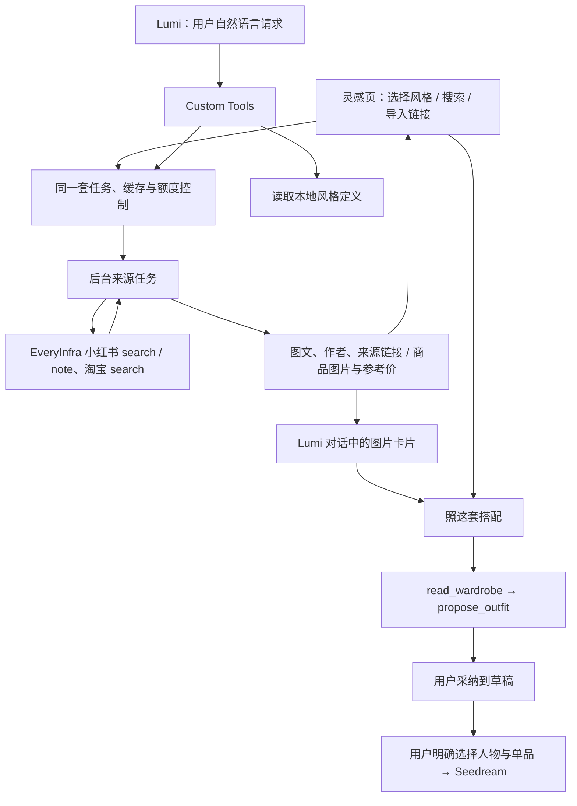

# 灵感、风格与商品：页面和 Agent 共用的内容能力

2026-11-24 更新。已实现 12 种风格定义、小红书图文检索与链接导入、淘宝商品搜索、Lumi Custom Tools 和图文/商品卡片。云端 Qoder Agent 已发布为 **v7**，并绑定原生 `muse-style-discovery` Skill 的不可变版本，本机 EveryInfra Key 已配置；真实平台查询、图片和 Agent 工具循环已验证。自动定时采集、图片视觉识别未在本次接入。应用已部署到现有 Railway `muse-web / production`，2026-11-17 已完成来源接入部署，v7 随本次 GitHub 推送同步应用版本；本地私照、衣橱数据与 `.env` 文件未随构建上传。

## 核心流程



页面按钮和 Agent 都使用 `enqueueInspiration`，不能各自调用供应商、各记一份额度。来源任务复用已有 Worker 的租约与数据库。Agent 等待图片时让出 Worker；同一工具事件恢复后读取原子任务，不重新搜索。查询本身可以完成一轮对话，不要求用户先拥有衣物，也不会伪造一套搭配。

## Agent 能力

| Custom Tool | 实际执行 | 费用控制 |
|---|---|---|
| `get_style_definition` | 本地 12 种风格的配色、廓形、单品、公式和场景 | 无数据源调用 |
| `search_inspirations` | 小红书图文搜索，返回图片 URL、摘要、作者与原文 | 一页；先查缓存 |
| `read_inspiration_note` | 用户提供或选中的一篇笔记全文与图片 | 按需；不批量展开搜索结果 |
| `search_products` | 淘宝搜索，最多 5 件商品的图片、参考价与价格口径、来源 | 用户明确要买/找缺失单品时；6 小时私有缓存 |

每个 Agent Session 最多三次来源工具调用；重复事件复用已存结果。模型不能传 `user_id`、服务端 Key 或任意请求地址。工具执行端从已认证任务确定归属。取消对话后，尚未提交的来源子任务不再发起收费请求。

业务策略位于 `packages/qoder/skills/muse-style-discovery/SKILL.md`，按需读取 inspiration/shopping/outfits 参考文档。发布器上传为 Qoder 原生 Skill，并以固定数字版本写入 Agent.skills；system 只保留角色和全局边界，不再拼接 Skill 全文。工具定义和后端执行继续由应用维护。上传、绑定、回退和 Session 版本规则见 [Qoder Skills 接入](../skills/qoder-cloud-agent/references/skills.md)。

对话直接展示工具返回的图片卡片，并保留原文入口。图片未做视觉识别：Agent 依据定义、文字和标签解释风格，不能声称看到了图中的具体单品。用户点击“照这套搭配”后，得到可编辑的自然语言请求，再发送给 Lumi。个人 Memory 仍沿用既有的确认偏好与反馈流程，搜索和浏览不会自动写入长期记忆。

淘宝 `search_products` 复用相同的任务、事件去重、Worker 和额度控制，结果作为 `product_search_result` 在对话内显示，不直接加入衣橱。点击“看看怎么搭”只填入可编辑请求，明确商品尚未购买。结果分别标注页面价、划线价、推广价；缺失价格不填 0，超预算结果不冒充满足筛选。未接入商品详情、评论、自动购买或推广分佣链接。

调用必须使用已注册的 Custom Tool 原名，不添加 `mcp__local__` 等前缀。真实 v5 联调发现一次模型错误加前缀，纠正后原会话成功；v6 已补充规则并通过新会话首次调用验证。不能用内置工具事件冒充客户端工具事件，也不能在后端执行未知名称。

## 平台接口与成本

仅使用 `POST /api/v1/social`：

- 搜索：`{platform:"xiaohongshu",action:"search",params:{keyword,content_type:"image",sort:"relevance",date_range:"any_time"},mode:"async"}`。
- 笔记：`{platform:"xiaohongshu",action:"note",params:{url},mode:"async"}`。保留笔记链接必需的查询参数；交给 Agent 的原文链接会移除访问 Token。
- 淘宝：`{platform:"taobao",action:"search",params:{keyword,limit:5},mode:"async"}`。可选 `min_price`、`max_price`、`sort`（`relevance` / `popular` / `price_desc`）、`tmall_only`，按目录原样传参；不自动翻页或展开详情。
- `202 + job_id` 只是受理。后端轮询 `GET /api/v1/jobs/{job_id}`，成功且结果可解析后才完成任务。

依据 [官方目录](https://api.everyinfra.com/api/v1/social/catalog?platform=xiaohongshu) 与 [计费说明](https://everyinfra.com/pricing.md)，核对时两个动作的目录价均为 **$0.005556/次**。以每月 12 个预设风格各获取 4 次、用户额外读取 200 篇全文估算：`(12 × 4 + 200) × 0.005556 = $1.377888`，约 **$1.38/月**。再增加 800 次自定义搜索约 **$5.82/月**。淘宝 [官方目录](https://api.everyinfra.com/api/v1/social/catalog?platform=taobao) 的 `search` 为 **$0.0135/次**，100 次为 `100 × 0.0135 = $1.35`。这仅是数据源估算，不含 Qoder、Seedream、存储和流量。

- 预设公开风格查询共享 7 天新鲜缓存。自定义小红书查询和笔记缓存按用户隔离，24 小时；淘宝查询按用户隔离，6 小时。
- 浏览页面、打开已有摘要、切换风格和刷新页面不会向供应商提交请求。缓存过期也不自动刷新；需要用户操作，或 Agent 响应用户的外部灵感请求。
- 不自动翻页、不建立付费采集定时器、不在浏览时调用 Seedream。空结果短缓存 1 小时。
- 默认全站每月上限：小红书搜索 1000 次、全文 200 次、淘宝搜索 100 次；按当前目录价最多约 `1200 × 0.005556 + 100 × 0.0135 = $8.0172`。这是保守的**提交尝试**上限，失败也占次数；不冒充供应商最终账单。月份按北京时间计算。
- 同一预设风格的并发查询共用缓存和来源任务；额度在数据库中加锁计算。单用户每日最多 20 个未命中缓存的来源任务。

图片仅保存供应商返回的允许域名 URL，不下载、转存或代理图片字节。外链可能失效或阻止热链，界面提供占位和原文入口；已验证淘宝图片 HTTP 200 且浏览器可显示。小红书实测返回 HEIF，Chrome 无法显示；同一 CDN URL 的格式参数改为 WebP 后可显示，后端与前端均处理该转换（覆盖旧缓存）。这只验证了本次样本，不保证全部外链长期可用。保留作者和来源不等于已取得商业转载授权。

## 配置与启用

现有 `.env` 不要覆盖。服务端填写：

```dotenv
EVERYINFRA_API_KEY=
EVERYINFRA_MONTHLY_SEARCH_LIMIT=1000
EVERYINFRA_MONTHLY_NOTE_LIMIT=200
EVERYINFRA_MONTHLY_TAOBAO_SEARCH_LIMIT=100
EVERYINFRA_DAILY_USER_LIMIT=20
```

没有 Key 时去 [EveryInfra Keys](https://everyinfra.com/app#keys) 创建。Key 只在 API/Worker 进程环境中，不能填入前端配置、Agent 系统指令或 Skill。代码、私照、私人衣橱不会上传给 EveryInfra；只发所需的公开查询词或笔记 URL。

```sh
npm run db:migrate
npm run qoder:setup -- --update-agent        # 仅预览，不联网
# 需要发布 Agent 配置时才执行下行；它会发送工具声明和指令，不启动收费 turn。
npm run qoder:setup -- --update-agent --execute
```

更新脚本使用 [Qoder Agent 版本并发控制](https://docs.qoder.cn/cloud-agents/agents-update)，回读确认后固定 `.env` 中的版本；重启 API 与 Worker 后，新对话采用新版本。已有 Session 保留创建时的版本。更新未知时保存本地 journal，先核对，不反复发布。此命令整体更新本地定义的 system/tools，请先审查本地定义；其他 Agent 字段不在更新请求内。

本次已执行发布命令，回读确认 v6 含 6 个业务 Custom Tools；Railway 应用也已切到 v6 并完成数据库迁移。前端没有 Key 时仍可浏览风格定义并把风格交给已配置的 Lumi；外部来源显示未开通。

## 恢复与验收

收费 POST 网络中断或结果未知时保存 request_id/job_id，不自动重发。能查询的请求用原标识核对；没有标识时保持待确认，需要管理员核对原任务，不换新请求“试一次”。429/503 的已知拒绝遵守 Retry-After，否则逐步延长；最多三次提交。`submit_unknown` 即使返回 503 也不重试。422 不猜参数。失败/退款使用响应中的 billing/refund 状态更新本地流水，未知金额不捏造结算值。

浏览器保存应用幂等键和任务 ID，刷新只恢复 GET；应用 POST 响应未知时点击“恢复原请求”仍使用原键。Provider API Key、供应商原始错误、私有内存读写内容不会放入公开事件。

```sh
npm run test:db
npm run build
MUSE_UI_URL=http://127.0.0.1:5182 node scripts/check-inspiration-flow.mjs
MUSE_UI_URL=http://127.0.0.1:5182 npm run test:ui
```

本次 `test:db` 全部 **129 项通过**，前端类型检查和构建通过。新灵感/商品流程与原有搭配/试穿浏览器回归通过；覆盖图片、价格口径、超预算标记、商品来源链接与“尚未购买”的请求衔接。

新增测试涵盖真实 PostgreSQL 下的异步任务恢复、跨用户隔离、并发去重、月度硬上限、退款、未知请求、Agent 工具事件重放和取消传播。浏览器测试拦截全部业务 API，验证灵感图片/全文/导入、刷新、稳定幂等键、对话图片卡片以及未配置状态；其中图片是本地测试素材，不能当作真实小红书验收证据。

### 本次真实联调（2026-11-17）

- 淘宝一次搜索得到 5 件商品；小红书一次搜索得到 20 篇图文。传 `limit:5` 不保证所有平台遵守，小红书结果后续按应用/Agent 展示上限裁剪，不把条数当作计费次数。
- 通过 request_id 查询供应商结算：淘宝 `$0.0135`，小红书 `$0.00555556`，合计 **$0.01905556**。没有调用商品详情/笔记详情，也没有重复付费采集。回执仅存本地 `.local/`，未提交。
- 两个真实 Qoder Session 合计 **1.29 credits**（v5 含一次纠正为 0.89，v6 首次调用成功为 0.40）。不把 credits 擅自换算为美元。联调使用公开查询和既有真实商品缓存，外部查询额度设 0，确认无额外 EveryInfra 提交。
- v6 新会话通过自然语言触发 `search_products` → Worker 读取缓存 → 持久化并回传工具结果 → Agent 完成，返回 5 件商品；不是前端伪造的工具事件。

### Railway 发布验收

2026-11-17 部署 `09577420-c9b1-460c-a7dc-324de24e6b78` 状态 SUCCESS，来自当前工作区的受控源文件快照（非新增 Git 提交）。原组内口令继续有效，12 件既有衣物与私有图片保留，数据库迁移完成；公网能力接口已开启 inspiration，前端包含淘宝商品卡片。云端使用 Key 读取既有淘宝/小红书任务分别得到 5/20 条，确认网络、鉴权和归一化正常；没有重新提交付费来源任务或模型生成。云端 Memory/Dream 保留原有关闭状态，需独立用户记忆绑定后启用。

### 原生 Skill（2026-11-24）

云端 Agent v7 已挂载 `muse-style-discovery`，不再把 SKILL.md 全文塞进 system；Skill 按用户意图读取灵感/购物/搭配参考。Memory 是否可用由 Worker 按 Session 实际绑定传入。发布器按内容指纹复用版本，下载 ZIP 比较完整文件内容，并在更新 Agent 时保留其他 Skills/Tools；未知写入先对账，不重复上传。

138 项测试、前端构建及浏览器流程验证通过。真实新会话已观察到 Read `/data/.agent/skills/muse-style-discovery/SKILL.md`，随后仅调用 `get_style_definition` 完成风格解释，没有无关衣橱、淘宝或小红书查询；该次模型用量 0.68 credits。再次执行发布命令仍为 v7，没有新增 Skill/Agent 版本。
