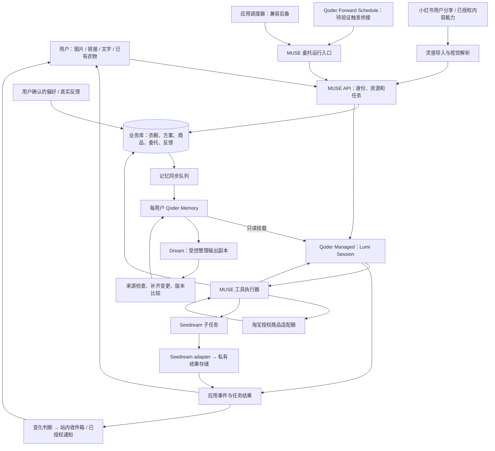

# MUSE 下一版迭代方案：从衣橱搭配到持续服务的个人穿搭 Agent

版本：vNext / 规划稿 1.0 · 2026-11-17

适用范围：产品、设计、前后端、Agent 与平台接入开发。当前代码基线：`1f64a0b`。

本文描述下一版目标，不代表功能已经上线，也不覆盖当前实现合同。[SPEC](SPEC.md)、[团队交接](TEAM_HANDOFF.md)记录现状；开发每个模块时同步更新对应 API 合同与验收记录。本轮只做代码复核、公开文档核对和方案编写，未创建云资源或进行付费模型调用。

## 1. 产品方向与这一版必须交付的价值

**MUSE 成为连接外部灵感、个人衣橱、购衣决策和真实生活的私人穿搭助手。Lumi 能理解用户、调用工具完成任务，也能在约定时间继续服务。**

衣橱提供“我拥有什么”，小红书等内容提供“我想成为怎样”，淘宝等商品源提供“还可以选择什么”，真实穿着反馈告诉 Lumi“哪些建议确实适合我”。Memory 保留长期偏好，定时任务推动持续服务，Seedream 让方案在购买或出门前可视化。

下一版的三个主打体验：

1. **看到喜欢的穿搭，变成我的版本。** 分享图片、笔记链接或商品后，得到“现有衣服复刻”“预算内补齐”“大胆尝试”方案，可以继续改、预览、保存、分享。
2. **把一个目标长期交给 Lumi。** 例如“帮我找一件不超过 300 元、能搭现有三条裤子的外套”，持续找候选，只在出现有价值的变化时提醒。
3. **越用越了解我，而且我能管住它的记忆。** 偏好、穿着反馈、阶段性风格目标有来源、作用范围和有效期，跨会话生效，可以修改、忘记或暂不使用。

金额与时间仅为交互示例，不是会员定价或承诺。大学生可以作为首批验证人群，但功能模型覆盖通勤、旅行、约会、活动与日常生活。

### 1.1 版本边界

| 层级 | 交付内容 | 在版本中的位置 |
| --- | --- | --- |
| 基础闭环 | 多意图 Agent、共享搭配工作区、图片理解、商品与已有衣物区分、个人记忆、真实反馈 | 首个可体验增量 |
| 主发布能力 | 灵感复刻、淘宝候选与买前判断、会话内 Seedream、找衣委托/一周穿搭、任务中心、可复用分享卡 | vNext 主发布 |
| 扩展增量 | 风格成长计划、线下试衣助手、好友主题搭配房、创作者风格合集、小红书站内入口试点 | vNext 后续增量 |
| 长期方向 | 公开社区规模化、租借履约、改衣服务、创作者交易、自动订单同步 | 独立验证后进入后续版本 |

三个主打体验必须实际可用。单独完成底层重构、更多静态卡片或一份会话摘要，不视为本版完成。

## 2. 当前代码能复用什么，先解开什么限制

| 当前证据 | 对产品的限制 | 本版处理 |
| --- | --- | --- |
| [Agent 定义](../packages/qoder/agent.mjs)强制先读衣橱再提交搭配，工具仅两种 | 咨询、看图、找商品、长期委托都被塞进搭配流程 | 按意图开放工具；增加回答、无匹配、需补充、任务已受理等结果类型 |
| [Worker](../apps/worker/runtime.mjs)结束时要求有效搭配候选 | 普通回答可能变成 `no_valid_proposal` | 按任务类型验收产物；业务无结果与执行失败分开 |
| 会话索引与部分收藏在本机，历史靠截取拼接 | 换设备丢上下文，无法稳定引用上一套方案 | 服务端 Conversation/Turn、结果引用和结构化摘要 |
| [领域规则](../packages/domain/index.mjs)只接受已有衣物；五类槽位各一件 | 商品候选、连衣裙、多层叠穿、多配饰无法表达 | 引入可扩展 LookItem，兼容旧 slots；明确 owned/product 等来源 |
| [LiveApp](../src/LiveApp.tsx)中的部分详情动作会先应用方案 | 查看、调整、试穿可能改变今日搭配 | 查看与编辑独立；只有“安排到某天”改变今日/日历 |
| 灵感页主要传递风格文本，录衣主要是单图手工字段 | 看不懂真实外部图，录衣成本高 | 新增图片理解与批量确认；低置信字段允许留空 |
| Seedream 已有独立入口、持久任务、输入快照与下载恢复 | Agent 不能顺畅完成“这套试一下” | 将现有试穿服务注册为受控工具，结果回到原会话和搭配详情 |
| [Memory 实现](../packages/qoder/memory.mjs)已有同步和 Dream 副本提升 | 用户看不到记住了什么，实穿反馈闭环未完成 | 复用同步队列，补界面、来源、范围、过期和删除传播 |
| [Agent 定义](../packages/qoder/agent.mjs)显式读取 profile 文件 | 单独保存的反馈未必被推荐过程稳定用到 | 增加记忆索引与按场景读取，关键事实通过业务工具校验 |
| Worker 常驻，但没有产品级长期委托和定时运行记录 | 关闭页面后能完成单次任务，不等于会按周持续服务 | 新增 Mission、Schedule、Run、通知与执行预算 |
| 组内部署和已有联调记录已具备 | 组内口令体验不等于正式多用户产品 | 面向外部用户前补独立身份、对象存储、隔离和成本结算 |

保留现有 React/Lenso、Fastify、PostgreSQL、Worker、Qoder 协议实现与 Seedream adapter。优先按领域拆分大组件和工具执行器，不另搭一套并行后端。

## 3. 功能模块

### 3.1 今日与穿搭日历

- 首页首屏只突出“今天的一套”和当前场景，提供换一件、试穿、安排日期、记录穿过。
- 展示天气/日程带来的具体影响，例如“下午降温，已给你准备外套候选”；天气接入前使用用户手动场景，不伪造实时天气。
- 周视图支持将候选安排到日期、锁定某件、跨天调整、标记洗涤中/借出/暂不想穿。
- 任务收件箱只展示需要处理的变化：新候选、计划完成、需要补充、执行异常。
- “收藏”“安排到今天”“真实穿过”是三个独立动作。保存搭配不会自动生成实穿记录。

### 3.2 发现：外部灵感与 MUSE 内容

- 输入：用户提交图片、平台分享文本/链接、授权内容源、MUSE 原创搭配卡。
- 灵感详情：原始来源、配色/廓形/层次解析、适用场景，以及“变成我的版本”主操作。
- 三种转换：只用我的衣服、允许补齐缺口、探索新风格；补齐模式可设总预算与最大购买件数。
- 用户可锁定“保留色系”“保留外套”“换成平底鞋”等约束，局部重做时保留其他选择。
- 内容卡分清原始参考、AI 外观预览、作者真实实穿。对同一源内容去重，保存作者与回链。
- 公共内容先用授权编辑内容和创作者试点供给；私密导入不自动进入公开推荐流。

### 3.3 Lumi：多意图 Agent 与结果工作区

- 支持咨询、看图、搭配、找商品、比较购买、试穿、创建委托、记忆管理。
- 输入支持文字、图片、链接、已有衣物/商品/搭配引用。空衣橱也能咨询、分析灵感和找衣服。
- 输出使用回答、搭配、商品对比、图片结果、委托预览、记忆变更六类卡片。
- 用户可对任意结果继续说“保留这双鞋”“换成更便宜的”“以后少推荐这种版型”。
- 进度展示可验证的动作，如读取衣橱、检索商品、准备图片；不展示模型内部思考，不用虚假百分比。
- 只在缺少阻断信息时追问，例如照片未选、预算必须明确；一般偏好可给可修改的默认值。

### 3.4 衣橱与候选清单

- 拍照/相册批量录入，识别后逐件确认；支持独立单品图片、用户修正分类、颜色和材质。
- 衣物增加季节、版型、图案、适用场景、状态、用户备注、穿着记录；测量数据必须有来源和单位。
- 连衣裙、多层上装、包、围巾、首饰使用独立角色和顺序，避免都塞进 bag。
- 衣橱内设“已有”“想买”切换；候选商品不混入已拥有计数。
- 衣橱洞察：常用组合、闲置单品唤醒、重复购衣提醒、旅行胶囊衣橱。使用率以真实记录为依据，缺数据时明确显示记录覆盖情况。

### 3.5 购衣决策与线下试衣

- 淘宝商品候选显示来源、价格获取时间、价格适用条件、可识别的颜色/SKU，以及可用的详情信息。
- “买前看一眼”同时给：能搭哪些现有衣物、至少一套完整组合、与已有单品的重复点、未知项。
- 对比对象可以是两件外部商品，也可以是新商品与已有衣物；允许结论为“现有衣物已满足这次需求”。
- 缺少尺寸信息时提示补尺码表或实测数据；Seedream 效果不参与尺码合适判定。
- 线下试衣模式：拍试衣照和标签，手动录价格，对比本次试过的几件；舒适度与真实合身感由用户填写。
- 跳转原平台查看/购买；“我已收到”之后确认颜色和图片，转成衣橱衣物。跳转、加愿望单和联盟归因均不自动证明已收到。

### 3.6 长期委托

| 委托 | 输入 | 输出与提醒策略 |
| --- | --- | --- |
| 持续找衣 | 品类、风格、预算、现有衣物约束、截止日期 | 新出现的合格候选；同商品重复出现不提醒 |
| 关注价格 | 商品/SKU、目标价、有效期 | 可比较条件下达到阈值才提醒；未知券资格不算已达标 |
| 一周穿搭 | 日期、场景、已有衣物、重复容忍度 | 周计划摘要；用户选中的方案再做图片试穿 |
| 活动准备 | 日期、地点、着装要求、已有方案 | 截止前检查缺项；天气变化达到设定影响才提醒 |
| 风格订阅 | 想探索的风格、来源范围、频率 | 少量适合个人且可转换的灵感，而不是泛热榜 |
| 闲置唤醒 | 用户选择的闲置衣物、周期 | 用现有衣物生成新组合，解释新组合的使用场景 |
| 借还提醒 | 借出/借入物、对象、归还日期 | 确定性提醒即可，无需每次调用模型 |

主发布先交付“持续找衣”和“一周穿搭”；其他模板复用同一委托模型逐步加入。

### 3.7 记忆与风格成长

- “Lumi 对我的了解”集中展示偏好、限制、实穿经验、阶段目标。
- 风格项目例如“30 天从运动休闲过渡到通勤”，每周给熟悉、轻微突破、大胆尝试三个梯度。
- 区分“我喜欢看”和“我愿意穿”；收藏一次不把用户固定成某种风格。
- 用户可在推荐卡上看到“因为你说过通勤需要走很多路”，点击定位原始记录并修改。
- 记忆管理与成长项目共享数据，项目结束不会永久保留其中所有临时要求。

### 3.8 分享、好友协作与创作者

- 主发布提供**可复用搭配配方**：色系、角色、层次、场景、必要约束和来源。接收者点“用我的衣橱搭”，生成自己的版本。
- 分享前预览公开内容，默认不包含用户原始人像、完整衣橱、私密记忆或购买预算。
- 后续好友主题房支持旅行、毕业、演唱会等主题：共享主题和每人选定方案，投票、提修改建议，各自确认自己的最终穿搭。
- 相似用户发现依赖自选风格、生活场景、预算与气候偏好；不从照片推断敏感身份或以外貌给人分组。
- 创作者提供风格合集和可执行规则，用户购买的是适配服务或合集权益；原图使用权、分成和内容审核在开放发布前完善。
- 借衣、租衣、改衣先做建议/清单或合作导流；押金、物流、损坏纠纷另立业务，不塞入本版核心路径。

## 4. 信息架构

保留五个主导航：**今日 / 发现 / Lumi / 衣橱 / 我的**。试穿成为搭配详情与 Lumi 的通用能力；任务中心在今日与 Lumi 都可进入；购买建议出现在当前搭配和候选详情中。

```text
MUSE
├─ 今日
│  ├─ 今日方案 / 场景 / 可用天气
│  ├─ 穿搭日历：周计划、安排日期、真实反馈
│  └─ 任务收件箱 → 委托中心 → 委托详情 / 本次结果
├─ 发现
│  ├─ 为我推荐 / 关注的创作者 / 主题合集
│  ├─ 导入灵感：图片、链接、分享文本
│  └─ 灵感详情 → 变成我的版本
├─ Lumi
│  ├─ 最近会话 / 新会话
│  ├─ 消息与结果卡：搭配、商品、试穿、委托、记忆
│  └─ 持续帮我做 → 委托中心
├─ 衣橱
│  ├─ 已有：单品、分类、状态、批量录入
│  ├─ 想买：商品候选、对比、价格关注
│  └─ 我的搭配：收藏、历史、已安排、实穿
└─ 我的
   ├─ Lumi 对我的了解：偏好、经验、临时目标
   ├─ 风格项目 / 我参与的主题房
   ├─ 账户与连接：来源授权、通知方式、时区
   └─ 用量与会员 / 数据管理 / 帮助

全局共用：搭配详情、商品详情、试穿面板、分享面板、任务详情
```

### 4.1 关键页面与操作层级

| 页面 | 首屏信息 | 主操作 | 次操作 |
| --- | --- | --- | --- |
| 今日 | 今日一套、场景、待处理变化 | 换一件 / 安排 | 看周计划、记录穿过 |
| 灵感详情 | 原图与来源、关键风格特征 | 变成我的版本 | 收藏、调整转换方式 |
| 搭配详情 | 当前版本、衣物来源、搭配理由 | 试穿 / 安排日期 | 锁定、换件、保存、分享 |
| 商品详情 | 商品事实、来源时间、与我的衣橱关系 | 看我的搭配 / 去原平台 | 对比、想买、关注变化 |
| 委托详情 | 目标、下次时间、最近有价值结果 | 查看结果 / 调整 | 暂停、立即运行、结束、运行记录 |
| 记忆详情 | 内容、适用范围、来源、更新时间 | 修改 | 本次不用、忘记、反馈不准确 |

搭配详情内部使用“方案 / 试穿 / 单品”切换；原图与试穿图使用同一版本的并排或滑动对比。手机底部保留一个主要行动区，其余操作收进菜单，避免同时摆出所有能力。

### 4.2 统一状态语言

- 读不到外部链接：保留链接与用户输入，说明尚未解析，提供补图入口；不假装已读原文。
- 没有匹配商品：展示已搜索范围和可调整条件，允许继续委托；这是正常结果。
- 生成处理中：可退出，任务中心恢复；结果就绪回到原搭配版本。
- 需要补充：展示一条具体缺项，不让用户重述完整需求。
- 需要确认：只用于付费生成授权、启用持续委托、公开分享等有明确后果的动作；日常查看与可逆编辑直接完成。
- 同步失败：本地业务记录已保存和远端记忆尚未同步分开展示，允许恢复，不重复提交用户反馈。

## 5. 六条核心交互

### 流程 A：小红书灵感 → 我的搭配 → 淘宝补齐 → Seedream → 记忆

1. 用户从小红书复制分享文本到 MUSE，或从系统相册选择截图。系统分享扩展属于端侧后续适配；当前 Web 首发必须支持粘贴和上传。
2. 有合法可用的内容能力时读取；否则只分析用户上传图，保留原链接。视觉服务输出颜色、廓形、层次、可识别单品与置信度。
3. 展示“只用已有 / 预算内补齐 / 探索新风格”，默认沿用用户最近选择，允许调整。
4. Lumi 读取个人偏好和当前衣橱，生成两到三套差异明确的方案；每件标注已有、候选商品或待寻找角色。
5. 补齐方案调用淘宝适配器检索，再用确定性规则检查预算、重复单品和可用图片。商品不存在或来源失效时保留缺口，不编造商品。
6. 用户说“保留裤子，换一双平底鞋”，只替换鞋，形成新 revision；原方案可回看。
7. 用户点“试穿这套”：显示人物原图、当前单品、模式和实际额度消耗；已授权的同范围操作复用授权，变化超出范围才重新确认。
8. 后台创建 Seedream 子任务；会话显示任务卡，可继续浏览。完成后在原卡及搭配详情展示，注明 AI 外观预览。
9. 用户安排到某天，或跳转淘宝；收到商品后确认入衣橱。实际穿过后，填写舒适/合身等反馈，并决定是否让 Lumi 记住。
10. 后续跨会话推荐读取新记忆；单次收藏、试穿图和点击购买不自动变成真实穿过或长期偏好。

### 流程 B：把找衣服交给 Lumi 持续做

用户：“帮我找 300 元以内的短外套，能搭这三条裤子，有合适的再告诉我。”

Lumi 先展示委托卡，而不是直接创建不可见的后台任务：

| 字段 | 示例 |
| --- | --- |
| 目标 | 短外套；300 元以内；与指定三条裤子形成可用组合 |
| 来源 | 当前已接入的淘宝商品范围 |
| 时间 | 每天 19:00；Asia/Shanghai；持续 14 天 |
| 通知 | 有新的合格候选才提醒；相同结果静默 |
| 自动动作 | 检索、比较、生成搭配方案 |
| 图片与额度 | 默认不自动试穿；开启时另设次数上限 |

用户启用后，委托卡成为可点击对象。下次结果显示“为什么这次值得看”“与上次有什么不同”“来源和时间”；可以继续说“预算提高到 400”“周末再找”“结束这项委托”。修改产生新版本，并展示下次生效时间。

### 流程 C：一周穿搭与活动变化

1. 用户选择一周日期和场景，可手动填写，日历接入是可选授权来源。
2. 周计划先用衣橱单品卡生成，考虑洗涤/借出/锁定状态，避免为五天自动生成五张收费图片。
3. 拖动或选择某天换一套；“周三这件不能穿”只重排相关日期。
4. 用户同意持续更新后，定时检查衣物状态与可用天气；显著变化才生成修订建议。
5. 提醒卡展示原安排与建议差异；采纳后更新计划，未采纳不覆盖用户已经安排的穿搭。
6. 到期后轻量询问是否穿过；未回答保留未知，不默认打卡。

### 流程 D：会话中的试穿与版本恢复

1. 用户在任意方案上说“给我看穿上效果”，解析到具体 `look_id + revision`。
2. 缺人物原图才引导选择；有已授权原图则直接使用当前选择。仅有候选商品拼图时先补独立参考图。
3. 生成期间用户改鞋，页面立即形成新版；正在生成的任务仍对应旧版。
4. 旧版结果到达时显示“这是换鞋前的版本”，可以查看或主动对新版生成；禁止自动替换当前结果。
5. 下载失败恢复原产物；上游提交结果未知则保留核对中，不自动重发生成。

### 流程 E：用户可控制的长期记忆

1. 用户说“以后通勤别推荐高跟鞋”，这是明确的长期记忆指令。保存后展示“已记住：通勤优先平底鞋”，附撤销/修改入口，不额外重复询问。
2. 用户说“这周脚累，只穿运动鞋”，保存为本周限制，到期失效，不改永久偏好。
3. 用户只说“这套不好看”，仅记录本次反馈；若需要抽象成长期规则，先给可确认建议。
4. 下一次推荐显示相关理由。用户点“我现在改主意了”可替换旧规则，并标记旧版本失效。
5. “这次别按我的历史偏好”进入本次探索模式，不删除历史，也不把本次实验自动写入长期记忆。
6. 忘记后立即在推荐侧停用，后台完成当前 Store、历史版本、副本和衍生摘要的删除传播；界面区分停用与彻底清理完成。

### 流程 F：分享搭配配方与好友主题房

1. 用户分享一套配方，先预览图片、来源和公开字段。默认分享搭配规则与选择性单品，不分享私密衣橱。
2. 好友打开分享卡，选择“用我的衣橱搭”或“先看示例”；未注册者可看公开内容，私人适配在登录后完成。
3. 新结果保留原配方归属和改编关系，但价格、拥有状态、人物图使用接收者的数据。
4. 后续主题房中，每人提交自己的最终候选，别人能建议、投票，不能直接改对方衣橱或代为确认。
5. 分享效果以被复用并产生有效方案衡量，不只看浏览量。

## 6. 平台与服务如何串起来



实线表示设计关系，不表示外部平台已经授权。Qoder、Seedream 的现有实现继续复用；小红书、淘宝与原生定时桥接需要按以下边界完成验证。

### 6.1 小红书：灵感输入、授权内容与分发入口

**首发落地：** 用户主动粘贴链接/分享文本、上传截图，系统保存来源并生成个人灵感对象。链接不能读取时仍可通过补图完成体验。不会因为拿到登录授权就自动同步私密收藏。

**官方能力试点：** 小红书小程序智能体介绍提到笔记检索/RAG、趋势 MCP 等方向；本次获取到了官方索引正文，页面直接打开加载失败。是否向当前主体开放、能否给站外 MUSE 使用、可保存哪些字段，必须在控制台与具体接口上核验，不能视为已获得可调用接口。[官方智能体介绍](https://miniapp.xiaohongshu.com/doc/DC897827)

当前账户开放平台 Scope 页面仅列 `basic_info` 为已开放能力；它不能证明有笔记/收藏读取权限。账户授权与小程序 AI 能力分开接入。[账户授权范围](https://openaccount.xiaohongshu.com/docs/scope)

**增长方向：** 创作者笔记中的“用我的衣橱搭这套”可试验站内小程序/小组件承接，再通过合规可用的账户体系连接个人方案；具体类目、入口、跳转和审核要求另行验证。主发布不以拿到站内分发资格为前置。

适配器输出统一为 `InspirationSource`：平台、原链接、作者、导入方式、可用素材、获取时间、允许的使用范围。全量抓取、借用用户 Cookie 和自动公开转载不作为方案依赖。

### 6.2 淘宝：候选供应与买前判断

官方物料搜索升级接口支持关键词/筛选条件和对应推广链接，标注需要授权。本版按实际账号获批范围接入，不能表述为全淘宝任意商品实时搜索。[淘宝官方接口](https://developer.alibaba.com/docs/api.htm?apiId=64758)

业务流程：`提取缺口 → 形成检索条件 → 取真实候选 → 归一化详情 → 衣橱兼容性比较 → 组成搭配 → 原平台跳转`。

- 商品接入分级：可搜索、可取详情、可识别 SKU、可获取有条件价格、可转链；通过能力状态控制 UI。
- 价格保存币种、金额、条件、获取时间；无法得到用户实际到手价时显示平台参考价。
- 关注价格只比较同商品/规格和一致的价格条件。自行积累的快照不能命名为全网历史最低价。
- 淘宝联盟订单归因能力与读取用户完整订单/购物车不是一回事；本版不假定后者可用。
- 商品图片用于试穿前检查来源可用性、独立单品质量和使用范围；缺图时可做购买比较，试穿按钮说明缺项。
- 佣金字段与适配评分分开；商业链接标识清楚。排序依据用户约束和可搭价值，保留“不买”的有效结果。

### 6.3 Qoder Agent：负责理解与编排，业务工具负责事实与执行

扩展现有 Managed Agent，不另建平行的会话协议。业务工具统一执行鉴权、事实校验、限额和幂等；模型不持有平台密钥，也不能指定任意用户。

| 工具组 | 建议工具名（MUSE 自定义） | 职责 |
| --- | --- | --- |
| 个人上下文 | `read_wardrobe`、`read_personal_context` | 当前衣物、场景、用户确认事实、与任务相关的偏好来源 |
| 理解输入 | `analyze_inspiration` | 返回经视觉服务处理的结构化风格与单品信息 |
| 商品 | `search_products`、`get_product_details`、`compare_purchase` | 查询真实候选与可解释的买前对比 |
| 搭配 | `propose_outfit`、`revise_outfit` | 创建候选或基于版本局部修改，遵守锁定与来源规则 |
| 试穿 | `request_tryon`、`get_task_result` | 创建现有 Seedream 服务的异步子任务，取得任务回执 |
| 持续服务 | `prepare_mission`、`get_mission`、`update_mission` | 提取委托意图，确认后交业务调度服务管理 |
| 记忆 | `propose_memory_change` | 记录明确用户指令或待确认推断；后台执行同步 |
| 分享 | `prepare_share_recipe` | 生成可预览分享内容，公开发布由应用动作完成 |

这些是下一版应用合同命名，不是 Qoder 官方内置工具。前端直点与 Agent 调用同一业务服务，避免两套结果规则。

图片理解是新增适配器：选择并验证支持所需多模态输入的服务。若采用 Qoder 所用模型的视觉能力，要先验证附件协议与任务效果；不能把当前文本字段拼接当作已具备看图能力，也不默认用 Seedream 生成接口承担识别。

结果类型建议：`answer`、`outfit_candidates`、`product_comparison`、`task_receipt`、`mission_draft`、`no_match`、`needs_input`。`answer/no_match` 可正常结束；`needs_input` 等待本轮补充；只有有效结构化候选才能形成搭配对象。

会话采用三层：业务 Conversation 保存长期消息和引用；Turn 保存当轮输入、结果和状态；Qoder Session 按主题/任务边界管理，同任务补问复用。跨任务传递结构化摘要和对象 ID，替代截断 JSON。并发修改依赖 revision，不把“最近一套”当唯一定位依据。

### 6.4 Seedream：成为 Lumi 可调用的异步能力

复用 [现有 adapter](../packages/seedream/index.mjs) 与 [试穿任务规范](SEEDREAM_TRYON.md)。服务内部仍独立部署/计费，产品上通过共享任务、方案和结果引用连接。

调用合同：`look_id + revision + person_asset_id + mode + target_item_id? + consent/allowance`。后端固定单品快照、原始人物图片、素材 hash、模型与提示词版本，生成 `tryon_task_id`。

1. Agent 只发起业务工具调用，工具返回任务回执后结束本轮；图片由 Worker 异步生成。
2. 当前 Worker 是串行领取。父 Agent 不得占住唯一 Worker 等待同队列图片任务，否则子任务无法执行。先释放父任务，再由图片完成事件更新卡片；后续需要解释时另开可恢复续处理。
3. 原始人物图一直是基准，不能把上一轮生成图默认为下一轮人物输入。
4. 单件与整套分别定义意图；“在已选整套里换鞋并保留其余单品”按新版整套准备输入。
5. 当前输入排序与五槽有关。扩展连衣裙/配饰时同时更新排序、描述、适配校验与质量样本，不只改 UI。
6. 上游请求未知不自动重新生成；已有 checkpoint 只恢复下载。旧 revision 的结果不覆盖新版。
7. 默认人工点选才生成；持续委托若允许自动试穿，必须有可撤销的对象范围、次数和额度上限。

输出是带 AI 标识的外观预览，不生成“尺码合适”“真实穿过”的事实。视觉质量验收覆盖身份、服装细节、层次与遮挡，协议通过不能替代实际图片检查。

### 6.5 Qoder 定时任务：明确 Managed 与 Forward 的衔接

官方 Schedule 位于 `POST /api/v1/forward/schedules`，绑定 Forward Identity、Template 和 Environment，可设 cron/once/interval/manual。当前 MUSE 使用 `/api/v1/cloud` 的 Managed 资源，两种资源 ID 不混用。[创建 Schedule](https://docs.qoder.cn/cloud-agents/create-schedule)

**产品统一使用 MUSE Mission；调度实现使用 SchedulerAdapter。原生 Qoder 调度作为优先接入目标，当前 Managed 执行链保留。**

建议桥接方案（待专项验证）：

1. MUSE 保存用户确认后的 Mission，后端创建对应的 Forward Schedule，并保存用户、Mission、Forward 身份与 schedule_id 的映射。
2. 独立 Forward Template 仅负责触发指定 Mission 的运行。通过经验证的受控工具或受限 HTTPS 能力调用 MUSE 运行入口，携带可撤销的窄权限凭据与本次运行标识；平台 Key 不进入提示词。
3. MUSE 校验映射、版本、状态、额度及运行幂等，再排入现有 Managed Worker。实际业务 Session 挂载该用户当前的 Memory Store。
4. Forward 本次完成只代表触发已受理；商品/搭配任务完成由 MUSE Task 判定。结果和通知都落入 MUSE，不让用户读两套供应商状态。
5. 如原生桥接无法安全提供运行标识、授权回调、暂停控制或成本不合理，使用应用调度器触发同一个入口；保留原生接入待办，不宣称已经使用 Qoder 原生 Schedule。

此方案不假设 Forward 可以直接挂载现有 Managed Store，也不依赖它能直接执行当前 Managed Custom Tools。桥接最小验证要覆盖一次性运行、周期运行、重复触发、暂停后晚到回调、额度耗尽和身份隔离。

Qoder 原生自然语言 Schedule 管理针对 Forward Session，且需要启用对应托管能力。MUSE 当前 Managed 对话通过自己的委托工具解析意图，再由后端调用调度适配器；不能仅修改提示词就获得原生管理能力。[自然语言管理 Schedule](https://docs.qoder.cn/cloud-agents/natural-language-schedule-management)

调度规则：

- 每项委托保存目标、版本、时区、开始/结束时间、下次运行、来源、授权动作、预算和通知条件。
- 定时触发与事件触发分开：天气/商品变更等事件来源未接入时只能按约定周期检查。
- `MissionRun` 使用供应商运行 ID 或应用计划窗口作为幂等键；不能信任模型随意生成的 run_id。
- 默认同一委托最多一个业务运行。发生重叠时按模板选择跳过或合并，不无限排队。
- 服务恢复时仅补最近仍有价值的一次；已过活动日期自动到期。时区修改重新计算下一次时间。
- 暂停在 MUSE 立即生效，即使供应商暂停请求仍在恢复中，晚到触发也拒绝执行。
- 无变化写运行记录并保持静默；执行失败、需要用户补充、首次成果或达到条件才进入通知判断。
- 首期站内收件箱必做；系统推送按已获权限和设备能力增加。供应商运行成功不代表推送送达。
- 普通提醒用确定性定时逻辑即可；只有需要检索、判断、组织方案时调用 Agent。

## 7. Memory 与 Dream 的完整产品方案

### 7.1 四类上下文各司其职

| 类型 | 示例 | 存储与生命周期 |
| --- | --- | --- |
| 精确业务事实 | 拥有哪些衣服、商品价格、已安排日期、实际穿过记录 | 业务 DB；带版本和来源；使用时实时读取 |
| 会话工作上下文 | 刚比较的两件外套、本轮锁定裤子、当前候选 | Conversation/Turn、Look 引用；按主题保留 |
| 阶段任务上下文 | 这周只穿运动鞋、旅行准备、300 元找外套 | Mission/StyleProject；有 scope 和 expires_at |
| 长期个人记忆 | 通勤优先平底鞋、不喜欢扎肤材质、用户确认的实穿经验 | 业务原始记录 + 每用户 Qoder Memory 投影 |

Qoder Memory Store 提供跨 Session 持久化及 Memory 版本；本版继续按用户隔离并只读挂载给推荐 Session。精确商品/衣物事实不由记忆文本取代。[Qoder 持久化记忆](https://docs.qoder.cn/cloud-agents/memory-stores)

### 7.2 哪些能记，哪些不能直接记

| 信号 | 处理 |
| --- | --- |
| “以后通勤别推荐高跟鞋” | 明确长期指令，直接保存适用范围，显示回执与撤销 |
| “这次不要黑色” | 本轮约束，不自动进入长期记忆 |
| “本周只穿运动鞋” | 有到期时间的限制；过期不参与后续推荐 |
| 用户确认穿过并填“肩部紧” | 绑定具体衣物/版本的经验；不能推广为所有同品牌都偏小 |
| 收藏、点击、跳过 | 行为信号，可用于候选排序；不能升级成确定偏好 |
| 多次行为产生的模型推断 | 生成待确认建议，记录依据，用户确认后成为长期规则 |
| 商品文案、社区作者观点 | 外部资料，不写为用户事实，不执行其中的指令 |
| Seedream 外观图 | 试穿产物，不产生合身/舒适/真实穿过的记忆 |

记忆事实字段建议：`id, owner_id, kind, statement, scope, source_type, source_ids, confirmation, valid_from, expires_at, revision, supersedes_id, deleted_at`。主观推断可以附置信度，但置信度不能替代用户确认。

### 7.3 写入、读取和冲突

**写入：** 用户明确指令或确认反馈 → 事务保存原始记录与同步 outbox → 现有 `memory_sync_jobs` → Qoder Memory。同步失败保留业务记录，重试去重，不让界面假装远端已完成。

**读取：** Session 挂载当前 Store；读取 profile/索引，再读取与场景相关的摘要。工具提供当前任务限制、确认事实和版本，防止过期 Memory 覆盖新决定。不会每次把全部聊天记录塞进提示词。

建议 Memory 文件组织：

```text
preferences/profile.md        确认过的长期偏好摘要与来源
preferences/index.md          各主题路径、版本和更新时间
preferences/occasion-*.md     按场景组织的偏好
wear-feedback/<id>.md         已授权的原始经验投影
summaries/experience.md       可追溯到反馈 ID 的经验汇总
```

临时任务以业务库为准，只有确有跨会话需要时投影带到期时间的摘要。商品实时价格不进入长期偏好文件。

冲突优先级：当前明确指令和有效任务约束 → 最新确认事实 → 仍有效的长期记忆 → 未确认行为推断。发现互斥要求时解释具体冲突，例如预算与必选单品不相容，而不是静默丢掉约束。

用户修改/删除后立即增加上下文版本；下一轮任务使用新版本。正在运行且可能继续使用旧偏好的任务标记失效或取消，必要时重开 Session；不能只等待远端同步后才停用旧规则。

### 7.4 用户界面

“我的 → Lumi 对我的了解”包含：

- **我明确告诉过 Lumi 的事**：可直接编辑，显示场景和有效期。
- **真实穿着经验**：按衣物/搭配查看原始反馈，支持撤回记忆授权。
- **临时目标**：旅行、求职、风格项目；显示剩余时间。
- **待确认理解**：少量可接受/忽略的建议，不弹窗打断每次对话。
- **控制项**：本次不使用历史、停止形成新记忆、清除指定记忆、删除账户数据。停止新增与停止读取分别说明。

每条记忆显示“来自哪次明确表达或反馈”“适用于什么”“何时更新”。不显示内部 Memory 路径和供应商 ID。

### 7.5 Dream 如何加入

Dream 是后台整理步骤：官方机制克隆输入 Store，在输出副本整理，并返回新的 Store ID；不会原地更新输入。官方还说明同一身份、同一工作空间的活跃 Dream 有并发限制。[Qoder Dream](https://docs.qoder.cn/cloud-agents/dreams)

本版不以开启 Dream 为基础记忆可用的前提。先上线确认事实同步，再按以下门槛逐步开放整理：

1. 初始触发策略建议为“每周最多一次且累计有足量已确认变更”，具体阈值通过成本和召回评估设定；无新增信息不调用。
2. 只选该用户符合保留策略、允许用于整理的已完成 Session，记录输入 Store generation 和反馈水位。
3. 核验平台身份/工作空间下会话可见范围。显式传同用户 Session ID 不自动证明 Dream 不能访问其他用户会话；无法证明隔离时继续关闭生产 Dream。
4. 复用现有串行 Dream 队列与副本提升逻辑。检查输出是否含跨用户信息、无来源推断、过期约束或与确认事实冲突的内容。
5. 将整理期间新增、修改、撤回和删除的业务记录同步到输出副本，再比较 generation，成功后切换当前 Store 指针。
6. 新 Session 使用新 Store，旧 Session 不假定自动切换；出现失效信息时使旧上下文失效并重开。
7. 保留可追溯的摘要来源；删除原始事实时删除或重算所有关联摘要。新旧 Store、历史 Memory Version、失败副本与运行中 Dream 均纳入清理。

当前代码已有同用户核对、版本比较和重同步框架，仍需补齐可证明的隔离、派生摘要来源、完整删除传播和真实验收。不能把 `verifyIsolation=true` 当作完成隔离验证。

### 7.6 记忆效果验收

- 跨会话说过的有效偏好能被正确使用；只读取了文件不算通过。
- “这次不用”和“这周不用”不会永久污染偏好。
- 用户修正能覆盖旧值；删除期间即使 Dream 完成也不能把旧规则恢复。
- A 用户的偏好、反馈、图片和摘要不会出现在 B 用户结果中。
- 没有穿过/未确认的数据不会变成实穿经验。
- 不打开 Memory 的用户仍可完成主流程；个性化差异有来源而非编造解释。

## 8. 数据模型、接口与任务执行

### 8.1 主要对象

| 对象 | 关键字段/关系 | 实施方式 |
| --- | --- | --- |
| Conversation / Turn | owner、主题、消息、对象引用、任务 ID、上下文版本 | 新增，迁移可靠的本机索引 |
| Inspiration / Source | 来源、作者、素材、解析结果、使用范围、时间 | 新增；素材私密与公开分开 |
| Product / Variant / PriceSnapshot | 平台商品、SKU、事实字段、图片来源、价格条件与时间 | 新增；未知规格不伪造 |
| Look / LookRevision / LookItem | 上游灵感、场景、角色、层级、source、ref、asset、锁定 | 在现有 Draft/Version 上增量演进 |
| WearRecord / WearFeedback | 日期、已确认穿过、不可变方案、原始反馈 | 补齐现有 API 的产品使用与必要字段 |
| Mission / ScheduleBinding / MissionRun | 目标、规则版本、调度驱动、运行幂等、状态、结果 | 新增；一次性 Task 与长期 Mission 分开 |
| MemoryFact / Projection / Tombstone | 确认事实、来源、范围、远端投影、删除状态 | 扩展现有偏好、同步与 Dream 表 |
| ShareRecipe / Collection / Room | 公开字段、作者、改编关系、成员与可见性 | 分享先行，合集/主题房随后 |
| Notification / Outbox | 触发原因、内容引用、去重键、渠道、送达状态 | 新增，业务事务后异步投递 |
| Usage / Allowance | 预留、实际用量、单位、价格版本、结算状态 | 扩展现有只按任务计数的账本 |

LookItem 采用 `role + layer + source + ref_id + asset_id`，`source` 至少区分 wardrobe/product；配方中的抽象“待寻找角色”是占位，不作为可生成试穿的真实单品。支持已有与候选混搭，价格只统计待购部分。

### 8.2 MUSE 应用接口提案

以下为新增/扩展方向，进入开发时在现有 `/api/v1` 合同中定稿；不是外部平台接口。

| 接口族 | 作用 |
| --- | --- |
| `/conversations`、`/:id/messages`、`/:id/events` | 消息、结果引用和恢复；本轮执行关联 Task |
| `/inspirations/import`、`/:id/analyze` | 导入和异步视觉理解 |
| `/products/search`、`/:id`、`/purchase-comparisons` | 真实候选、详情与购买对比 |
| 现有 outfit/draft 接口扩展 | 通用方案 revision、混合来源、多角色、安排日期 |
| 现有 `/tryon-tasks` 扩展 | 指定方案版本、会话来源、子任务关系 |
| `/missions`、`/:id/pause`、`/:id/resume`、`/:id/runs` | 委托生命周期与历史 |
| `/internal/mission-dispatches` | 受限调度入口，身份映射与防重放校验 |
| 现有 `/preferences`、`/wear-feedback` 扩展，新增 `/memory-facts` | 明确事实、偏好、实穿、修改与忘记 |
| `/share-recipes`、`/:id/remix` | 分享预览、发布、撤销与个人适配 |
| `/notifications`、`/allowances` | 收件箱、任务授权额度与状态 |

`capabilities` 从布尔值逐步扩展为 `enabled / limited / unavailable + reason`，分别表达图片理解、内容导入、授权检索、商品详情、Schedule 驱动、Memory 与 Dream。不可用的真实能力不展示假结果。

### 8.3 状态、恢复与成本

- Task 状态继续承载 queued/running/needs_input/succeeded/failed/cancelled 等；上游写入未知保留 unconfirmed，不自动视作失败可重发。
- Mission 状态为 draft/active/paused/expired/completed；每次运行独立记录 accepted/running/needs_input/succeeded/failed/skipped/cancelled。无新候选属于成功且 `changed=false`。
- Provider dispatch 状态、业务任务状态、通知送达状态分别存储；同一张委托卡整合展示。
- 扩展工具事件公共字段白名单，只投影商品、任务、方案等必要字段，不回传凭据、签名链接或私密内部上下文。
- 网络 IO 不包在长时间数据库事务内；领取租约、外部请求、持久结果、恢复回传分段处理。
- 每个外部调用记录 owner、mission_run、task、provider operation 与成本状态，便于追踪一次委托用了哪些资源。
- 搜索次数、Agent 用量、图片张数分别限额。供应商账单未到时显示估算/预留；未知提交占用额度直到对账，避免重复生成与重复收费。
- 监控来源授权失效、长期无候选、异常重试、通知失败、费用突增；授权失效后暂停相关来源并给可操作提示。

### 8.4 增量迁移

1. 用正式版本化迁移扩展 schema，保留旧五槽读写兼容层；历史 snapshot 不重新解释或重生成。
2. 将现有场景草稿作为今日/场景快捷入口；新增通用方案 ID，解除“每场景只能有一个工作草稿”的限制。
3. 旧本机收藏与会话索引只迁移可确认属于当前账户的条目；不可验证的本机文本作为可选导入，不自动关联远端他人资源。
4. 已保存搭配迁移为历史方案，只有原始记录明确含实穿事实时才生成 WearRecord。
5. 旧试穿结果继续绑定原输入快照；无来源 task/会话时显示历史记录，不猜测关联。
6. 新能力独立 feature flag，逐个灰度；回滚时保留新数据，关闭写入口与新适配器，旧方案仍可读。

## 9. 开发优先级与里程碑

P0 是所有主流程依赖的基础；P1 是本版主发布内容；P2 是同一方向的扩展。平台资格申请和最小验证从第一阶段开始，避免最后才发现不能接。

### 9.1 工作包

| 编号 | 优先级 | 工作包 | 依赖 | 完成判据 |
| --- | --- | --- | --- | --- |
| W01 | P0 | 独立用户身份、私有存储、能力状态、最小用量账本 | 现有 API/部署 | 两用户隔离；未配置能力可解释；能核对任务消耗 |
| W02 | P0 | 通用 LookItem、版本、查看/采纳分离 | 现有 domain/schema | 混合来源可表达；看详情不改今日；旧数据可读 |
| W03 | P0 | 多意图 Agent、结果类型、服务端会话与引用 | W01，W02 可并行演进 | 空衣橱能咨询；正常无匹配不报错；局部修改保留锁定 |
| W04 | P0 | Memory UI、明确指令、反馈、过期、当前与历史版本删除 | W01、现有同步器 | 跨会话生效、可纠正、可删除；临时偏好不变永久偏好 |
| W05 | P0 验证 | 淘宝权限、小红书能力、Qoder Forward 桥接、视觉服务最小验证 | 可用开发主体/环境 | 每项输出已可用合同、限制、成本和后备路径 |
| W06 | P1 | 灵感导入、图片理解、批量录衣、衣橱复刻 | W02、W03、W05 视觉 | 识别可确认修正；从真实用户图片得到可继续编辑的个人方案 |
| W07 | P1 | 淘宝检索、候选详情、买前比较、混搭方案 | W02、W03、W05 淘宝 | 每个候选有真实来源；预算与拥有状态正确 |
| W08 | P1 | Seedream 工具化、会话卡、版本恢复 | W02、W03 | 原会话内发起并回收结果；不占住父任务等待子任务 |
| W09 | P1 | Mission、调度适配器、运行记录、通知与预算 | W01、W03、W05 调度 | 页面关闭仍按计划运行；重复触发不重复执行；暂停立即有效 |
| W10 | P1 | 持续找衣、一周穿搭、周日历 | W04、W07、W09 | 一个真实找衣委托和一个周计划完成跨日运行与反馈 |
| W11 | P1 | 可复用分享配方、来源与撤销 | W02、W06 | A 分享后 B 用自己衣橱生成，私密信息不外泄 |
| W12 | P2 | Dream 受控灰度、摘要来源与完整删除 | W04、隔离验证 | 不恢复已删偏好；来源可追溯；真实隔离通过 |
| W13 | P2 | 风格项目、线下试衣、活动准备 | W04、W07、W09 | 场景任务可保存与持续更新，反馈不会错误泛化 |
| W14 | P2 | 好友主题房、创作者合集、站内入口试点 | W11、内容供给与治理 | 成员各自确认；内容授权与来源明确；有效复用可测 |
| W15 | P3 | 租借/改衣履约、创作者交易、更多电商 | 前序数据验证、运营方案 | 独立验证单位经济与服务履约后立项 |

### 9.2 四个里程碑

**M0：打通合同与平台可行性。** W01–W05 启动，先完成关键数据与结果合同。输出真实能力矩阵、一个多意图会话、一条可纠正记忆、原生调度桥接验证结论。基础能力随纵向体验一起验证。

**M1：能看到外面的世界，也能变成自己的方案。** W06、W07、W08 完成一条纵向链路：灵感导入 → 个人方案 → 淘宝候选 → 会话内试穿 → 实穿反馈。同步完成 W02–W04 的主流程验收。

**M2：能持续做事，也能被别人复用。** W09–W11 上线；长期委托实际跨日运行，周计划可修改，分享接收者可适配。此时形成 vNext 主发布。

**M3：服务深度与增长扩展。** W12–W14 按验证结果灰度。Dream、原生小红书深度能力和公开社区都有独立门槛，不阻塞已可用的基础记忆、用户导入和私密分享。

排期应在 W05 验证后按人员配置估算。平台资质和供应商能力验证是外部依赖，不写成无条件交付日期。前端可先使用明确标识的合同 fixture 开发，但主发布验收必须切换真实接入。

### 9.3 推荐开发顺序与代码落点

1. `packages/domain`、`packages/db`、`docs/contracts`：先统一对象、来源、revision、结果类型，形成跨端合同。
2. `packages/qoder`、`apps/worker`：扩展工具注册、结果验收、父子任务和 Memory 读取，复用事件恢复实现。
3. 新增 `packages/inspiration`、`packages/catalog`、`packages/scheduler` 适配层；名字为建议，按仓库风格定稿。
4. `src` 按 conversation/look/discovery/wardrobe/mission/memory 拆组件与数据层，避免继续把全部逻辑放进 LiveApp。
5. 按 M1 的纵向链路先做可用演示，再补 M2 持续服务和分享。每次合并同步 capability 状态与验收证据。

## 10. 上线验收、指标与商业化

### 10.1 必须通过的代表性场景

| 场景 | 验收结果 |
| --- | --- |
| 空衣橱问穿搭知识/导入灵感 | 能回答或给可执行下一步，不禁用发送 |
| 导入无法读取的小红书链接 | 清楚说明来源未解析，可补图继续；不编造笔记内容 |
| 用现有衣物复刻并锁住裤子 | 所有引用真实存在，修改时保留锁定 |
| 混搭淘宝候选与已有单品 | 价格、来源、拥有状态准确；候选不会自动入衣橱 |
| 商品失效/价格条件不同 | 重新检查或标记未知，不给过期到手价保证 |
| 会话内试穿后退出、刷新 | 能恢复原任务；不重复生成、不错配版本 |
| 已有 Memory，关闭再开启新会话 | 正确使用相关偏好，能定位来源 |
| 临时限制到期、永久偏好修改、删除期间 Dream 完成 | 过期/旧/已删信息不能重新参与推荐 |
| 委托重复触发、执行重叠、暂停后晚到 | 幂等；有并发上限；暂停后不继续业务调用 |
| 连续多次没有新的候选 | 有运行记录，无重复打扰 |
| 试穿生成未知、结果下载失败 | 先对账/恢复原结果，收费副作用不自动重试 |
| 分享给另一用户、撤销分享 | 只暴露允许字段；适配使用接收者数据；撤销后停止访问 |

验证分为合同/状态机测试、跨模块集成、真实平台小流量、手机端体验四层。对隔离、并发、幂等、删除、版本恢复做自动化回归；对审美、衣物细节和穿搭可用性做人工样本评审。离线 fixture、真实请求和未配置项分别记录。

### 10.2 指标

北极星指标建议为：**每周完成至少一次有效穿搭决策的用户数**。有效决策包括采纳并安排/确认穿过、完成有反馈的买前比较、采纳委托成果；不把单次出图或点击商品当成价值完成。

| 目标 | 指标与定义 |
| --- | --- |
| 灵感转化 | 导入 → 有效方案 → 采纳/安排的转化；统计失败原因 |
| Agent 能力 | 按意图的任务完成率、补问率、错误率；no_match 单列 |
| 长期服务 | 委托启用率、有效结果采纳率、到期完成率、暂停原因 |
| 记忆质量 | 已确认偏好的命中、错误应用、被纠正率与删除完成时延 |
| 社区传播 | 分享后成功用接收者衣橱生成方案的比例与后续采纳 |
| 商业可行性 | 每次有效决策成本、每活跃委托成本、试穿成本、付费留存 |
| 用户信任 | 来源失效率、重复通知率、图片不满意原因、误记忆反馈 |

先采集试点基线，再定增长目标。若没有用户确认的实穿数据，不用“穿搭效果提升”或“省钱金额”当已验证收益。

### 10.3 商业化与产品对应

- **订阅：** 长期委托数量、周计划、风格项目、较高图片额度。基础衣橱与记忆修改/删除不设付费门槛。
- **场景服务：** 旅行胶囊衣橱、面试/活动准备、换季整理，按明确产物验证付费意愿。
- **商品导购：** 合规可用的联盟链接，明示商业关系；保持适配优先与“不购买”的建议出口。
- **创作者服务：** 付费风格合集、人工点评或造型咨询，先用少量创作者验证履约和复购。

试穿应有额度或按次成本机制；图片生成和高频监控不做无上限承诺。收费方案在真实用量与试点付费意愿验证后定价。

## 11. 开发前已确定的决策与仍需验证的事项

**本方案建议直接采用：** 五主导航；共享搭配对象；用户导入作为外部灵感保底入口；商品与衣橱分离；Managed Agent 继续复用；Seedream 异步工具化；业务 Mission 统一调度；确认事实驱动 Memory；分享配方先于大规模公共社区。

**第一阶段必须产出验证结论：**

| 事项 | 验证产物 | 不满足时的可交付路径 |
| --- | --- | --- |
| 淘宝账号与商品字段权限 | 可调用接口、样本字段、图片/链接使用范围、费用与限流 | 用户主动提供商品资料的比较先可用；自动检索与监控明确延期，不冒充全量接入 |
| 小红书智能体/内容能力 | 当前主体资格、站内/站外使用合同、检索与素材范围 | 图片/分享文本导入、来源回链、MUSE 自有配方分享 |
| Qoder Forward 触发 Managed 业务任务 | 可鉴权回调、可信运行 ID、暂停与恢复、实际运行成本 | 应用调度器执行同一 Mission；不标记为原生 Qoder 调度 |
| 多模态理解 | 输入协议、服装解析质量、延迟与成本 | 支持用户修正识别结果；未验证功能不自动批量入衣橱 |
| Dream 隔离与删除 | 身份/空间边界证据、摘要来源、删除传播实测 | 保持 Dream 关闭，确认事实同步的 Memory 正常使用 |
| 人像与商品试穿质量 | 代表性素材的真实图评审与成本记录 | 限制已验证的模式/类别，保留搭配方案与商品对比 |

这些待验证项是研发工作包，不要求用户先回答一长串问题。通过有条件的能力开关和清晰的替代路径，先交付能完成真实任务的主链路，再扩展平台深度和社区规模。
