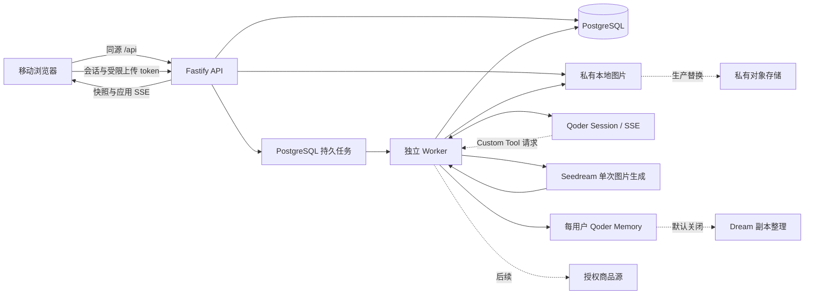
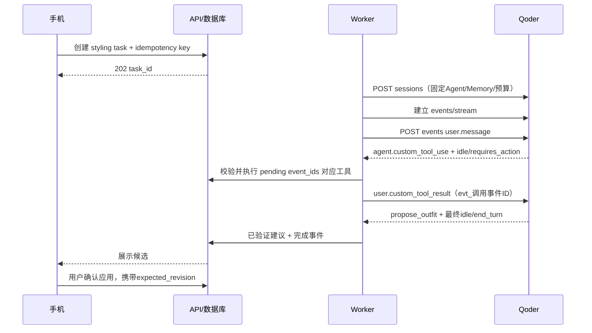

# MUSE 产品与技术规格 v1.1

2026-11-17 前端增量：[AI 对话与搭配内容流](AI_CONVERSATION.md) 记录中央 AI 入口、原生事件展示、图片卡片、灵感/我的和当前本机索引边界。其余业务任务与供应商接口沿用本规格。

状态：本地开发版已实现并完成部分真实联调；生产上线前仍有明确待办。更新：2026-11-16（Asia/Shanghai）。本文同时记录当前行为和后续产品范围，后续项不代表已经交付。

本规格取代早期 `IMPLEMENTATION_PLAN.md` 中以实时视频为首发试穿能力的安排：**首发为 Seedream 参考图图片试穿，Decart 为后续独立实时能力**。长期记忆使用 Qoder 原生 Memory / Dream，不使用 OpenViking。

## 0. 阅读和交付入口

| 文件                                                     | 用途                                                    |
| -------------------------------------------------------- | ------------------------------------------------------- |
| 本文                                                     | 产品范围、状态、架构、数据、流程、上线与验收的共同基线  |
| [API 契约](contracts/openapi.json)                       | MUSE 自有 API v1.1，OpenAPI 3.1；已实现/保留路由见第5节 |
| [本地启动](LOCAL_DEVELOPMENT.md)                         | Docker、API/Worker、手机访问、配置与故障排查            |
| [团队开发说明](TEAM_HANDOFF.md)                          | 分工、配置边界、联调与完成标准                          |
| [Qoder 接入 skill](../skills/qoder-cloud-agent/SKILL.md) | 可复制给同学的独立 skill，附协议、请求样例与调用脚本    |
| [Seedream 试穿](SEEDREAM_TRYON.md)                       | 模型输入、任务状态、存储、质量验收、失败处理            |
| [协议参考](../server/reference/README.md)                | 可移植的早期协议参考；应用入口现在是 apps/ 与 packages/ |
| [场景搭配](SCENE_OUTFITS.md)                             | 本次三个场景的前端实现和兼容策略                        |

### 当前交付与验证边界

| 状态                     | 范围                                                                                                                                                                                                               |
| ------------------------ | ------------------------------------------------------------------------------------------------------------------------------------------------------------------------------------------------------------------ |
| 已实现                   | React/Lenso Live 与演示模式、三场景草稿、手动录衣、私有图片、保存记录、任务恢复；Fastify、PostgreSQL、独立 Worker；Qoder 两工具；Seedream 单件/整套；偏好和反馈 API、Memory 同步                                   |
| 已真实联调               | 开发 Qoder 认证/模型查询、专用 Agent v1 与 Environment；两次成功的五件衣物搭配和只读 Memory 挂载；Seedream 单件适配器与手机界面请求、五件整套 API/Worker 请求及结果转存；Memory Store 建立、偏好文件同步及远端读取 |
| 已有开发实现，未真实验收 | Dream 手动发起/核对/副本提升；默认关闭，只有离线模拟验证                                                                                                                                                           |
| 仍待完成                 | 正式 OIDC、生产对象存储、完整供应商删除、费用结算与运营限流；识别/抠图；商品/趋势数据源；全部偏好反馈界面；规模、真机与代表性图片质量验收                                                                          |
| 暂不交付                 | 支付下单、自动购买、社交社区、自动尺码承诺、Decart 实时视频正式接入                                                                                                                                                |

本地默认空衣橱。12 件体验素材和三个场景仅通过显式 `npm run demo:seed` 导入，并保留“体验”标记。公开 Sites 仍是静态演示，不与本机 PostgreSQL 自动同步。最终次数和中断记录见 [VALIDATION](VALIDATION.md)。真实联调记录证明链路可运行，不代表所有模型效果、成本、隔离和生产条件已经验收。

## 1. 产品目标与核心行为

帮助用户从自己拥有的衣服出发，决定今天穿什么，探索风格，并在有明确缺口时判断新衣服是否值得买。

第一版核心闭环：**今日搭配 → 自由替换 / AI 建议 → 图片试穿 → 保存或记录真实反馈 → 下一次推荐更了解用户**。衣橱是事实来源，灵感是可选入口，购买建议是补充决策。

| 模块       | 输入                           | 输出 / 主要动作                          | 空态与失败                                       |
| ---------- | ------------------------------ | ---------------------------------------- | ------------------------------------------------ |
| 今日       | 场景、每场景草稿、已有衣物     | 显示整套；点单件换衣；整套编辑；保存     | 新用户提供明确标记的示例或引导加衣；不冒充已有   |
| 衣橱       | 相册 / 拍照 / 合法商品来源     | 用户确认的衣物卡片、分类、收藏           | 识别失败保留原图并允许手填；抠图不是添加前置条件 |
| AI 搭配    | 草稿版本、场合、偏好、锁定单品 | 有真实衣物引用的候选与理由               | 信息不足询问；无合适组合可明确返回无建议         |
| 灵感       | 用户主动浏览的风格 / 季节资料  | 收藏；尝试用自己的衣服搭出类似感觉       | 热度信息必须有来源与日期；示例专题明确标记       |
| 购买建议   | 预算、候选商品、已有衣橱       | 新增花费、可复用单品、完整组合、购买链接 | 库存 / 尺码表未知就显示未知；不伪造价格          |
| 图片试穿   | 本人照片、确定版本的服装参考图 | 一张生成效果图，可重新生成 / 保存        | 不更改原搭配；错误时展示明确重试入口             |
| 我的与反馈 | 保存记录、真实穿过及感受       | 历史搭配、偏好管理、删除                 | 收藏 / 试穿预览 / 实际穿过分开记                 |

### 今日三个场景的确定规则

三个入口为“轻松日常 / 周末漫步 / 见面时刻”，API 使用 `daily/weekend/meeting`。演示模式首次载入不同的确定性组合；Live 新用户的三个草稿均为空，需录衣或显式导入体验数据。切换后恢复各场景的最后编辑。演示模式恢复固定模板；Live 的“恢复场景推荐”恢复本机记录的该场景已采纳 AI 建议，历史保存记录不删除，不冒充一次新模型调用。

整套编辑使用临时草稿：取消不写回，应用一次性写回；单件替换直接写回当前场景。排版、锁定、草稿版本均属于具体场景，不跨场景覆盖。删除衣物后检查所有草稿引用，展示缺失位置，不静默换成另一件。保存历史保留当时快照，原图删除按隐私策略同步失效。

## 2. 技术决策

| 层       | v1 选择                                          | 理由与边界                                                               |
| -------- | ------------------------------------------------ | ------------------------------------------------------------------------ |
| 客户端   | 现有 React + TypeScript + Vite + Lenso，PWA 基础 | 保留工程；移动浏览器和主屏幕入口；不保证离线 AI                          |
| 业务 API | Node.js + Fastify 5，当前为 ESM `.mjs`           | 开发会话、业务 CRUD、任务提交、事件流；推荐 Node22，已在 Node24 联调     |
| Worker   | 同仓库独立 Node 进程                             | AI 任务不依赖手机长连接或页面生命周期                                    |
| 存储     | 当前 PostgreSQL 17 + 私有本地文件                | DB 存事实和状态，`.local/media` 存照片和结果；生产 S3/TOS/OSS 适配待实现 |
| 队列     | 初期 PostgreSQL 任务表 + lease + SKIP LOCKED     | 小规模团队避免同时维护 Redis；后续可替换队列实现                         |
| AI 编排  | Qoder Cloud Agents Managed API                   | 固定版本 Agent；每任务 Session；Custom Tools 执行业务逻辑                |
| 记忆     | 每用户 Memory Store；Dream 手动开发入口          | DB 是精确事实源；Store ID 保存到 DB；Dream 默认关闭，自动整理待实现      |
| 图片试穿 | Seedream images/generations，默认单图输出        | 人物图 + 单品图，不经过 Agent 转发图片字节                               |
| 实时试穿 | Decart，后续可选                                 | WebRTC 视频与图片生成独立实现和计费                                      |



### 为什么保留业务后端

Qoder Environment 是 Agent 执行环境，不是 MUSE 网站托管服务器。Custom Tools 的“client-side”指 Qoder 调用方；在本项目中调用方是 Worker。数据库密钥、商品凭据和 Ark API Key 不注入 Agent 环境，也不交给手机。

普通换衣与保存由前端 / API 处理，不触发模型费用；首屏读取已有结果。用户主动请求“帮我搭”才提交 AI 任务。Seedream 试穿直接是独立图片任务，无须先让 Agent 决定是否调用模型。

## 3. 手机使用与部署拓扑

### 当前本地开发拓扑

`npm run dev:full` 启动 Docker Compose PostgreSQL、迁移、API、Worker 和 Vite。Vite `0.0.0.0:5179` 代理 `/api` 到 `127.0.0.1:8787`，PostgreSQL 映射为本机 `55432`，图片存于 `.local/media`。媒体 URL 是同源相对路径，不把手机指向电脑的 localhost。

`GET /me` 在开发模式建立固定用户会话并返回 CSRF token。cookie 使用 HttpOnly/SameSite=Lax，HTTPS 时启用 Secure；写请求校验精确 `APP_ORIGIN/APP_ORIGINS` 与 CSRF。PUT 图片使用会话与受限上传 token。此固定身份供本机联调，同服务的访问者共享开发身份，不是已完成的多用户身份系统。`NODE_ENV=production` 目前明确拒绝启动。

手机访问电脑可达 IP 的 `5179`，并把精确来源加入 `APP_ORIGINS`；本机网络或 IP 变化后更新配置。文件选择上传可在局域网 HTTP 使用，前端有 SHA256 的本地实现回退。相机、正式身份和完整 PWA 验收使用 HTTPS。PWA manifest/图标不等于离线缓存；不缓存私人 API、授权链接或照片。

公开预览：[Sites 静态演示](https://muse-mobile-wardrobe.gentle-dell-0151.chatgpt.site)。它不运行 Node Worker/PostgreSQL，也不因 GitHub 推送自动更新。演示数据与 Live 业务数据分开。

### 生产目标，尚未部署

自有 HTTPS 域名提供前端与 `/api/v1/*` 同源代理；服务运行 API/Worker，数据库和私有对象存储独立持久化。选定 OIDC 供应商后实现服务端 code flow + PKCE，并校验 issuer/audience/state/nonce。当前 `/auth/login`、`/auth/callback` 返回未配置，不能当作现成登录。

若继续用 Sites 承载正式前端，需另做外部 API/Worker、跨域及身份桥接设计，不把当前 Node 长任务架构当作 Sites 内置能力。开发、staging、生产必须分离数据库、媒体和供应商资源。生产还需备份、删除策略、监控与真机验收；不能公开本地固定身份。

## 4. 领域模型与数据约束

当前迁移见 `packages/db/schema.sql`；下表中的商品与推荐聚合属于后续范围。内部 ID 使用 UUID；Qoder ID 为不透明字符串；时间为 UTC ISO 8601；显示按用户时区；未来商品金额用整数“分”+ currency，禁止浮点加总。

| 表 / 聚合                | 核心字段                                                                                                                                        | 约束                                                                                               |
| ------------------------ | ----------------------------------------------------------------------------------------------------------------------------------------------- | -------------------------------------------------------------------------------------------------- |
| users / auth_sessions    | 用户、固定开发 subject；会话 ID、owner、CSRF、过期时间                                                                                          | 会话归属统一；users.deleting 冻结新写入                                                            |
| media_assets             | id, owner_id, kind, object_key, mime, bytes, sha256, status, expires_at                                                                         | 私有；status=uploading/ready/deleting/deleted；生成输入只能引用 ready                              |
| garments                 | id, owner_id, name, category, garment_kind, color, material, image_asset_id, measurements, source, revision, deleted_at                         | category=coat/top/bottom/shoes/bag；后续可扩展；拥有状态需用户确认                                 |
| outfit_drafts            | id, owner_id, scene, revision, slots, canvas_layout, updated_at                                                                                 | 每用户每场景一个活动草稿；slots 含 source/asset/ref ID；revision 乐观锁                            |
| outfit_versions          | id, owner_id, draft_id, source_revision, snapshot, worn_date                                                                                    | 不可变快照；同一次保存幂等                                                                         |
| tasks                    | id, owner_id, type, status, stage, progress, input_snapshot, result, error, cancel_requested_at, lease_until, lease_token, next_run_at, attempt | styling/tryon 已运行；其他类型受能力限制；stage/progress 可为 null                                 |
| task_events              | task_id, seq, type, payload, created_at                                                                                                         | 唯一(task_id,seq)，由服务端递增；用于手机补事件                                                    |
| idempotency_records      | owner_id, route, key, request_hash, response, expires_at                                                                                        | 同 key 同 payload 返回原结果；不同 payload 返回 409                                                |
| agent_sessions           | task_id, owner_id, qoder_session_id, agent_version, memory_store_id, cursor                                                                     | qoder_session_id 唯一；同任务补问复用；活跃 turn 单飞                                              |
| agent_events             | session_id, event_id, payload, processed_at                                                                                                     | 唯一(session_id,event_id)，只持久化完整 buffered 事件                                              |
| tool_calls               | session_id, call_event_id, owner_id, name, input, result, state, lease_token                                                                    | 唯一(session_id,call_event_id)，结果持久化后回传                                                   |
| provider_operations      | task_id, owner_id, operation_key, kind, state, input, output, error                                                                             | 唯一 operation_key；pending/dispatching/done/rejected/unconfirmed，兼作发送意图与结果检查点        |
| product_variants（待建） | provider, external_id, sku_id, title, image, price_fen, currency, available, fetched_at, source_url                                             | 商品和已有衣物分开；价格是有时间的快照                                                             |
| recommendations（待建）  | task_id, product_refs, wardrobe_revision, combinations, evidence                                                                                | 保存计算规则版本、去重后组合和来源                                                                 |
| preferences              | owner_id, revision, data, updated_at                                                                                                            | 确认的风格/版型偏好，带乐观锁                                                                      |
| wear_feedback            | id, owner_id, outfit_version_id, actually_worn, fit_by_part, comment, consent_to_memory                                                         | 原始记录优先；模型不能改写用户原话                                                                 |
| memory_bindings          | owner_id, workspace_key, active_store_id, generation, last_feedback_seq                                                                         | owner 独立；Store 提升用 generation 比较更新                                                       |
| memory_sync_jobs         | owner_id, resource_key, generation, state, error                                                                                                | 唯一(owner_id,resource_key,generation)；含 waiting_config/waiting_dream，用户级锁避免吞掉更新/删除 |
| dream_jobs               | id, owner_id, input_store_id, input_generation, session_ids, provider_id, status, output_store_id                                               | 保存反馈水位；队列按上游身份/工作空间串行                                                          |
| usage_ledger             | owner_id, task_id, provider, operation_id, reserved, settled, unit, state                                                                       | 当前用于任务数/图片预留与冻结，不代表已实现真实 credits/人民币结算                                 |

当前 Slots 允许空槽，分类限定为 coat/top/bottom/shoes/bag；bag 也承载围巾等配饰，由 garment_kind 辅助区分。当前有效搭配仅接受 `source=wardrobe`。下例的 product 属于后续合同范围：

```json
{
  "top": {
    "source": "wardrobe",
    "ref_id": "uuid",
    "asset_id": "uuid",
    "locked": false
  },
  "bottom": {
    "source": "product",
    "ref_id": "uuid",
    "asset_id": "uuid",
    "locked": false
  }
}
```

购买建议中new_cost_fen仅在所有待购价都已知时给总额；否则为null并返回cost_complete=false、known_subtotal_fen及未知项，不把未知价格视为免费。

后续购买能力中，source=product 不计入“已拥有”。届时保存搭配可含待购商品但必须明显标识；用户确认购买并收到后才转换为衣橱衣物。试穿固定 snapshot，不引用随后可变的 draft 当前值。

measurements 用 `{value, unit, measurement_type, source}`；measurement_type 区分人体围度、服装平铺半围、服装整围。未知值为 null，不能拿“胸宽 50”直接与人体胸围 90 比较。尺码计算由代码处理单位和松量，数据不足返回 needs_information。

## 5. API 公共约定

API 基础前缀 `/api/v1`。公开字段以 [OpenAPI v1.1](contracts/openapi.json) 为准，当前实现位于 `apps/api/app.mjs`。表内明确区分已运行入口和保留接口。

- 当前开发 cookie 鉴权；匿名可读取能力说明。`GET /me` 可建立开发会话；其余私有资源越权返回 404。正式 OIDC 待实现。
- GET /me 返回会话绑定的 csrf_token；POST/PATCH/DELETE 携带 X-CSRF-Token，并校验 Origin 白名单。媒体 PUT 使用会话、Origin 与上传 token，不能将其视为匿名上传。
- JSON 字段 snake_case；客户端发送记录 ID，不发送 owner_id 或上游凭据。
- 创建任务和保存操作要求 `Idempotency-Key`；记录至少保留 24 小时（项目策略）。重复提交只创建一次业务操作。
- 修改草稿 / 衣物携带 expected_revision，冲突返回 409 + current_revision；客户端提供重载/重新应用选择，不静默覆盖。
- 成功对象直接返回；列表 `{data,next_cursor}`；错误 `{error:{code,message,retryable,request_id,details?}}`。错误文案不能包含密钥、签名 URL 或全量照片内容。
- 请求体默认上限 256 KB；照片不走 JSON API，而通过受限图片上传路由。单图上限 10 MB；建议长边约 2048px，当前不承诺自动缩放。相对媒体 URL 使用 uri-reference，收到后按页面来源解析。
- 任务创建返回 202 `{task_id,status}`，手机随后 GET 快照并订阅 SSE。不要让手机等一次长 POST 才拿到结果。

| 路由                                                                    | 当前行为                                                                                        |
| ----------------------------------------------------------------------- | ----------------------------------------------------------------------------------------------- |
| GET /capabilities                                                       | 返回 mode=live 与 ai_styling/image_tryon/realtime_tryon/memory/dream 布尔开关；配置缺失不假成功 |
| GET /auth/login，GET /auth/callback                                     | 保留接口，返回 503 identity_provider_unconfigured                                               |
| POST /auth/logout；GET /me                                              | 开发会话退出、当前用户、CSRF 与本地任务额度                                                     |
| DELETE /me                                                              | 创建删除任务并冻结账户；云端记录未完整清理时明确报待人工核对，不宣称删除成功                    |
| GET/POST /garments；GET/PATCH/DELETE /garments/{id}                     | 手动衣物 CRUD、owner 过滤、版本检查；图片必须 ready                                             |
| POST /media/uploads；PUT/GET /media/{id}/content                        | 创建上传记录、带会话/token 上传或下载私有图片                                                   |
| POST /media/{id}/complete；GET/DELETE /media/{id}                       | 校验、图片信息/新链接、删除；删除会使相关成功生成图失效                                         |
| POST /media/{id}/retain                                                 | 显式保留试穿结果，取消默认过期                                                                  |
| GET/PATCH /outfit-drafts/{scene}                                        | 三场景草稿及 expected_revision 乐观锁                                                           |
| GET/POST /outfits；GET/DELETE /outfits/{id}；POST /outfits/{id}/worn    | 保存快照、历史与真实穿过标记                                                                    |
| POST /styling-tasks                                                     | 仅 intent=style 已实现；purchase 返回未配置                                                     |
| POST /tryon-tasks                                                       | single/outfit，固定人物与服装快照，返回 202                                                     |
| GET /tasks/{id}；GET /tasks/{id}/events                                 | 快照与独立应用 SSE，可恢复                                                                      |
| POST /tasks/{id}/cancel；POST /tasks/{id}/messages                      | 持久取消意图、needs_input 补答；终态/活动 turn 不接受补答                                       |
| GET /inspirations；GET /products                                        | 当前返回空列表；真实数据源未接入，另有明确标记的静态演示                                        |
| POST /wear-feedback；DELETE /wear-feedback/{id}；GET/PATCH /preferences | 确认记录与同步/删除意图；完整设置界面尚待补齐                                                   |
| POST /garment-extraction-tasks；POST /tryon/client-token                | 保留接口，分别返回识别/实时视频未配置                                                           |

`POST /tryon-tasks` 要求 `mode`；single 必须有 `target_slot`，outfit 禁止该字段且草稿至少一项非空。`OutfitProposal.slots` 是服务器验证后的可采纳槽位。`TryonResult` 含 `result_asset`、`person_asset_id`、`mode`、实际使用的 `slots` 和原草稿版本。

### 应用 SSE（与 Qoder SSE 分开）

```text
id: 42
event: task.updated
data: {"task_id":"uuid","status":"running","stage":"reading_wardrobe","progress":null}

id: 43
event: task.updated
data: {"task_id":"uuid","status":"running","stage":"composing","progress":null}
```

完成时的 outfit.proposed/tryon.completed 事件携带公开任务对象，候选或结果在 result 字段。`seq` 为应用事件游标，不是 Qoder evt_。GET 快照返回 last_event_seq；流从该游标后续传。断线重连、手机切后台后先补快照；过期游标触发重新取快照。服务器先落数据库再发事件。心跳每 15 秒，代理关闭缓冲；不向 UI 转发模型内部思考或完整工具原始数据。

## 6. Qoder 集成规格

使用 Managed API，CN 基址 `https://api.qoder.com.cn/api/v1/cloud`。当前 `packages/qoder/client.mjs` 扩展可移植 HTTP/SSE client，凭据仅存在服务端私有字段；不依赖前端或 Qoder Environment 保存平台密钥。支持 PAT 或已置换 SAT；生产 SA 自动兑换/刷新尚未实现。以后采用官方 qca-sdk 时须固定版本并显式选择 CN，不混用 Forward 字段。完整协议见 [skill](../skills/qoder-cloud-agent/SKILL.md)。

当前通过 `scripts/qoder-setup.mjs` 显式准备开发资源，默认预览，不随 Worker 启动自动创建。Agent 定义在 `packages/qoder/agent.mjs`；Worker 与持久记录在 `apps/worker/runtime.mjs`。

资源关系：一个版本化穿搭 Agent + Environment 配置可复用；每用户独立 Memory；每次独立业务任务一个 Session；同任务后续补问复用 Session。任务快照固定 Agent ID/version、Environment 和预算，已有 Session 保存其挂载 Store。模型用当前 `/models` 返回值。角色、预算、工具集合变化时建立新版本，不影响正在执行的 Session。

### 工具合同

| 工具                          | 参数                               | 返回                                           | 执行者                            |
| ----------------------------- | ---------------------------------- | ---------------------------------------------- | --------------------------------- |
| read_wardrobe                 | 可选 category                      | 衣物 ID、名称、属性、缺失项                    | Worker，owner 取自 task           |
| propose_outfit                | garment_ids, reason                | 经校验的 outfit_proposal                       | Worker 保存建议；用户应用才改草稿 |
| search_products（阶段二）     | query, category, max_price_fen     | 有实际来源的商品快照                           | 商品适配器，搜索不发送身体信息    |
| get_product_details（阶段二） | product_id, sku_id                 | 图片、价、库存、尺码、来源时间                 | 商品适配器                        |
| evaluate_purchase（阶段二）   | product_id, draft_id               | 成本、可搭单品、完整组合与未知项               | 规则引擎                          |
| calculate_fit（阶段二）       | product_id, measurement_profile_id | size_candidates / needs_information + evidence | 规则引擎，不看生成图测尺码        |

内置工具首期只允许 Read 读取挂载的个人记忆。不要把 `enabled_tools: []` 当作关闭：当前契约下这代表全开；不需要内置工具时省略整项。Custom Tools 必须在 Worker 中做 JSON Schema 校验、权限检查、资源归属检查和费用检查；提示词不能替代这些检查。



`propose_outfit`参考实现返回内部outfit_candidate，不是可直接发给手机的OutfitProposal。Worker先校验类别、锁定位置、去重、owner与快照revision，在事务中生成proposal_id并持久化，再补齐draft_revision和公共schema字段；返回过程不能信任模型生成的业务ID。

### 状态机与恢复

应用任务状态：queued → running → waiting_tools → running → succeeded；也可 needs_input / failed / cancelled / unconfirmed。cancel_requested 是取消意图，终态要根据实际执行确认。Worker 状态和手机连接状态独立。

needs_input 返回 Task.question；POST /tasks/{id}/messages 携带 Idempotency-Key 接收补答，复用本任务Session且回到queued。只有needs_input允许补答；活跃turn、终态和草稿版本冲突返回409。当前只在 end_turn 且没有有效候选时接受明确的 `{kind:"needs_input",question:"..."}` 最终 JSON，并限制问题长度；普通自然语言疑问或 idle 不直接变成 needs_input。

server/reference 的 taskState 返回内部协议信号：waiting_for_tools映射waiting_tools，recovering映射running+stage=recovering，turn_ended需候选/取消判定后才给应用终态，terminated按取消或错误映射，unknown先恢复对账。内部信号不能原样作为公共Task.status。

Qoder 的 session.status_idle 不是一律成功：requires_action 表示等工具；end_turn 也需检查本地取消标记和已验证结果；其他原因映射成错误或待处理。agent.message、thread_idle、SSE EOF 都不是成功信号。

首次 SSE 不带 Last-Event-ID 从尾部开始，不重放历史：先订阅成功再发送消息。恢复已有 Session 时补读历史（按 next_page 分页）并接续流；完整事件按 ID 去重，业务副作用按调用 ID 去重。首期不启用 event_deltas，后续启用时 start/delta/final 可能共用 ID，不能把它们一并去掉。

工具执行：数据库领取租约 → 执行 → 持久化结果 → 回传。返回请求超时不能重新执行业务；先查是否已有相同 custom_tool_use_id 的结果，再决定回传。对于创建 Session 响应丢失：标为 unconfirmed，按任务 metadata 和可用历史核对，不能盲建第二个。只在目标接口明确支持时用上游 Idempotency-Key，应用自己的键不能自动保证上游幂等。

手机取消：先写 cancel_requested_at，再 POST Qoder sessions/{id}/cancel；关闭 SSE 不等于取消云执行。工具和首次/补答消息发送前保存意图；消息对账只匹配 baseline 之后的新事件，避免把相同文本的旧补答误认为本轮成功。Worker 重启时领取过期租约，带 lease_token 防止旧执行者写回，先对账再运行；未知状态保留为未知，不能伪报成功。

## 7. Memory 与 Dream

当前实现位于 `packages/qoder/memory.mjs`，通过 `npm run memory -- provision <用户UUID>` 显式建立用户 Store；服务启动不自动创建 Store。已真实验证偏好写入和远端读回。

Memory 保存确认过的偏好与经验，数据库保存事实和原始记录。推荐 Session 默认只读挂载该用户 Store。Memory未开启时省略resources，衣橱搭配仍可运行，不以Memory配置阻塞最小闭环。后端把用户明确确认的反馈按路径去重写入，例如 `wear-feedback/{feedback_id}.md`；聚合偏好文件保留 provenance 和 updated_at。

创建 Memory Store 后，可写初始 `preferences/profile.md`；没有内容时允许空档案，不能臆测偏好。更新 Memory 使用 POST，并带上读到的 content_sha256；409 重新读取并按原始事实合并。Memory 列表不含完整 content，需取单项。

Memory 同步由持久 jobs 驱动；偏好/反馈修改和同步共用 owner 锁，API 等待有上限。未绑定 Store 为 waiting_config；删除等待进行中 Dream 时保留 waiting_dream，不吞掉删除意图。

Dream 不在实时请求里跑。当前仅实现手动发起与核对命令，DREAM_ENABLED 默认 false，未执行真实 Dream；“有新确认反馈时每日批处理”是后续策略。显式传同一用户的 Store 与 1–100 个已完成 Session，避免空列表扩大回顾范围。输出是新 Store 副本：

1. 记录 input_store_id、generation、反馈水位。
2. 创建 Dream，保存 drm_ ID 后轮询至终态。
3. 校验输出、归属与来源；补齐任务期间新增反馈和删除 tombstone。
4. 用 generation 比较更新用户 active_store_id；若版本冲突则重新对账，不覆盖。
5. 下一次新 Session 使用新 Store；旧 Session 不自动更换挂载。

同一身份/工作空间的活跃 Dream 有并发限制，队列串行。显式 session_ids 是输入范围，不可宣称它替代平台隔离；上线前必须测试 Dream 的会话回顾边界。若共享凭据仍可能读到别的用户上下文，暂停生产 Dream，使用独立业务空间/服务账号隔离后再启用。Memory 正常读写可先上线。

当前删除账户创建 account_deletion 任务并冻结写入，只允许读取本人删除任务；不能恢复旧 needs_input 任务。有平台 Session、Memory 或未核对操作时返回明确的清理待办并保持冻结，不宣称供应商数据已删除。无云端依赖的本地清理路径会清除业务敏感内容并撤销会话。完整供应商删除及可重放运营流程仍待实现。

删除反馈已清理原始文字并排队删除可定位的当前/历史/副本条目；已 redact 的版本跳过。用户照片不写 Memory。Dream 可能把内容改写到其他摘要路径，目前不能仅凭原反馈路径证明派生内容彻底删除；完整来源追踪或 Store 重建、偏好历史清理与平台隔离均是启用生产 Dream 的前置项。

## 8. Seedream 图片试穿

当前方案是**原始人物图 + 确定版本的单品参考图 → 一张外观预览**。已实现 single/outfit，并完成一次单件红色针织衫及一次五件整套真实请求。它们不替代代表性样本质量验收；复杂叠穿、身体遮挡与细节保真仍需评估。

官方当前多图接口支持 Seedream 5.5，示例 Model ID 为 `doubao-seedream-5-5-261028`。项目通过 `ARK_IMAGE_MODEL` 配置实际已开通 Model ID 或 Endpoint ID；正式启用前验证账户权限、效果和价格，不自动开通付费资源。5.5 最多10张参考图，项目 v1 限制为1张人物＋最多5张单品图。

上游 `POST https://ark.cn-beijing.volces.com/api/v3/images/generations` 是图片请求；**我们自己的 API 才返回 task_id**。不得臆造 Seedream jobs 查询接口。输入与输出详细合同见 [SEEDREAM_TRYON.md](SEEDREAM_TRYON.md)。

图片适配器在 `packages/seedream`；单件只替换原照片的目标槽，整套使用当前非空槽位。图序固定为人物、coat/top/bottom/shoes/bag；garment_kind 区分围巾等配饰。当前服务器从私有文件构建 data URL，产物检查点先落库，再下载转存。

角色分离：Qoder 组织搭配和解释，Worker 固定图序与提示词版本，Seedream 生成，用户判断是否喜欢。生成结果不回流为“真实穿过/尺码合适”的事实。

## 9. 衣物录入、推荐与尺码

上传先生成私有 asset_id 和受限上传 URL；对象 key 由服务端生成。完成回调后验证实际 MIME、大小、解码尺寸、SHA256、归属，清理 EXIF；有效后才变 ready。当前支持手动录入，识别任务入口返回未配置。后续识别/抠图输出候选属性，仍须用户确认后保存 garments，不把抠图作为录入前置条件。

以下商品、预算、趋势和尺码规则为后续产品范围，目前商品/灵感 API 返回空列表，购买 intent 未开放。

商品适配器输出统一 ProductVariant；只接一个经授权的数据源作为首期。URL 输入只解析允许的电商域名，禁用任意 URL 抓取；短链解析也需每跳校验，防止 SSRF。价格和库存按打开商品/购买跳转前刷新，过期快照不假称实时。

“能搭几件”与“几套”分别计算：匹配单品数=去重后的已拥有单品；完整套数=满足品类/场景约束且经规则评分的完整组合去重数。展示实际组合列表及截断上限；锁定单品优先保留。预算以新增商品去重后的 SKU 成本计，已拥有成本为0，运费/优惠未知时单列说明。

风格推荐可使用编辑内容作为冷启动；季节趋势使用带日期和出处的内容，过期时只称风格参考。初期无需独立向量数据库；确有大规模检索需求再增加检索层。

尺码只依据身体测量、参考衣物、商品尺码表、材质与真实反馈。输出包括推荐范围、依据、缺失字段和风险，不输出未经校准的“95%合身”。

## 10. 隐私、成本与可观测性

- 当前公共素材在 public，私人图片在 .local/media；生产需分桶/路径；有签名的图片链接不入日志或 Memory。用户主动确认后才将其照片发送到 Seedream，界面说明用途、供应商和保存范围。
- 照片删除：本方对象、衍生结果、引用和正在排队任务一并处理；供应商侧保留遵循真实协议，不能承诺未经确认的立即全平台删除。
- 项目默认保留策略（可调）：未确认上传24小时清理；临时人物照片24小时清理；未收藏结果7天；用户主动保存的结果保留到删除。建立清理任务与审计记录。
- 当前按用户/任务类别限制每日数量并记录 usage_ledger；未发出请求可释放，已发出但费用未知的失败/取消冻结额度。上游 usage 保留在操作检查点。真实 credits/人民币结算、IP/供应商层限流仍待完善，不能把本地余额当供应商账户余额。
- Qoder 配每 Session credit 上限；Ark 单任务默认1张输出。费用 UI 只用真实配置价格与账户策略，不把示例数字当收费标准。
- 当前保存任务时间、阶段、操作状态、可取得的上游 request_id 和错误码；不向 UI 发内部思考或原始工具内容。完整 trace/阶段耗时聚合与运营日志尚待建设。日志不得包含密钥、隐私提示词或图片链接。
- 生产监控目标：队列年龄、任务成功率、SSE恢复率、重复拦截、首结果耗时、真实成本、Memory积压、Dream冲突；当前没有宣称这些看板已部署。

## 11. 测试与验收

| ID  | 场景                           | 验收                                            |
| --- | ------------------------------ | ----------------------------------------------- |
| F01 | 三场景切换、自由换衣           | 三套确实不同；每场景草稿/排版独立；刷新保持     |
| F02 | 整套选衣关闭 / 应用            | 关闭不改首页；应用只改当前场景                  |
| F03 | 老版本本地记录                 | 升级保留衣橱、收藏、已保存搭配，不全量重置      |
| B01 | 两账号互读 ID                  | 衣服、草稿、照片、任务、Memory均不可串读        |
| B02 | 同键重复创建 / 不同body        | 同body同任务；不同body返回409；不重复费用       |
| B03 | revision冲突                   | 不覆盖对方修改；用户可重新应用                  |
| Q01 | 模型工具引用不存在衣服         | 拒绝候选，返回可恢复工具错误                    |
| Q02 | SSE断流、手机后台、Worker重启  | 补历史/快照，不重复执行工具，不误报完成         |
| Q03 | 工具回传响应丢失               | 对账已回传记录，不重新执行业务                  |
| Q04 | end_turn无有效候选 / 已取消    | 不显示成功搭配                                  |
| M01 | Dream运行时新增/删除偏好       | 提升副本前回放变更；不复活已删除内容            |
| M02 | Dream租户隔离                  | 无跨用户检索；不通过则禁用生产Dream             |
| I01 | Seedream基础换装               | 人物身份、衣服颜色/图案、遮挡和四肢由人工盲评   |
| I02 | HTTP200含error/空data/下载失败 | 不标成功；提示失败或保存中；禁止重复计费重试    |
| I03 | 生成中改搭配                   | 结果对应原snapshot，并提示不是当前草稿          |
| I04 | 取消 / 删除照片                | 不承诺上游已停止；晚到结果按取消/删除策略清理   |
| P01 | 实体iPhone/Android             | HTTPS、主屏幕、上传、键盘、后台恢复、安全区正常 |

性能目标（待实测）：普通换衣交互100ms内可见；普通API p95<500ms（不含图片上传/上游AI）；AI任务提交1秒内返回task_id；首个任务状态2秒内可见。图片生成耗时不预设服务保证，记录至少30个有授权的代表样本，报告成功率、p50/p95、细节保真和真实成本后确定UI文案及套餐。

当前 `npm test` 自动发现测试；缺少 TEST_DATABASE_URL 时数据库用例明确跳过。`npm run test:db` 使用独立 muse_test 库并移除模型凭据；测试覆盖越权、幂等、租约、历史分页/EOF恢复、未知写入、结果取消竞态、原图删除、Memory同步删除竞态与 Dream 重复提升。CI 使用 Node22/PostgreSQL 跑检查。

CI 必须维持类型检查、生产构建、协议/状态/越权/幂等与合同校验。真实模型接入、图片质量、Dream隔离、实体手机和性能分别验收；真人照片不进入测试仓库。本文只列已确认的开发联调事实，最终 UI/CI 验证另行记录。

## 12. 研发分工与里程碑

| 阶段       | 当前状态                                    | 下一交付                                       |
| ---------- | ------------------------------------------- | ---------------------------------------------- |
| A 接口基线 | OpenAPI v1.1、前后端基本对齐                | 接口变更同步类型、校验和样例                   |
| B 业务底座 | 开发身份、私有文件、CRUD、持久任务已运行    | 正式 OIDC、对象存储、完整删除与运营限制        |
| C Agent    | 两工具、恢复、固定版本/预算已实现并真实联调 | 扩充场景样本、消息补答和真实成本记录           |
| D 图片试穿 | 单件/整套、检查点、结果保存已真实联调       | 代表性质量样本、真机与复杂叠穿验收             |
| E 偏好     | Memory 同步已联调，Dream 手动路径离线验证   | 完整偏好/反馈 UI、删除来源追踪、Dream 隔离验收 |
| F 购买     | 规则与合同保留，尚未接入                    | 一个授权数据源、SKU/预算/尺码证据              |
| G 发布     | 尚未生产部署                                | staging HTTPS、备份、监控、真机、高优先级验收  |

每个PR写清关联接口、状态迁移、异常处理、验证方式；接口变更先更新OpenAPI及样例。不要每个同学单独修改App全局状态。配置说明、开发入口与分工提示见 [TEAM_HANDOFF.md](TEAM_HANDOFF.md)。

## 13. 上线前待定项

当前开发账号的 Qoder 模型/Agent/Environment 与 Ark 图片权限已验证；这不代表其他同学账号也已开通。上线仍需确认：业务身份与域名/云部署、生产存储和备份、真实延迟/成本、Dream隔离及派生内容删除、代表性试穿质量、供应商照片留存与完整清理、商品数据授权/覆盖率。生产 SAT 刷新、费用对账和运维指标必须在公开运营前补齐。

文档核对来源：Qoder [Managed API概览](https://docs.qoder.cn/cloud-agents/api-overview)、[创建Session](https://docs.qoder.cn/cloud-agents/sessions-create)、[工具](https://docs.qoder.cn/cloud-agents/agent-tools)、[事件发送](https://docs.qoder.cn/cloud-agents/api/sessions/events/send)、[SSE](https://docs.qoder.cn/cloud-agents/api/sessions/events/stream)、[初始连接变更](https://docs.qoder.cn/cloud-agents/sse-initial-connection-behavior-change)、[Memory](https://docs.qoder.cn/cloud-agents/memory-stores)、[Dream](https://docs.qoder.cn/cloud-agents/dreams)、[认证](https://docs.qoder.cn/cloud-agents/api-authentication)、[SDK](https://docs.qoder.cn/cloud-agents/sdk/typescript)；火山方舟 [图片生成API](https://console.volcengine.com/ark/region:cn-beijing/docs/image-generation-api)、[图片生成教程](https://console.volcengine.com/ark/region:cn-beijing/docs/image-generation-tutorial)。
