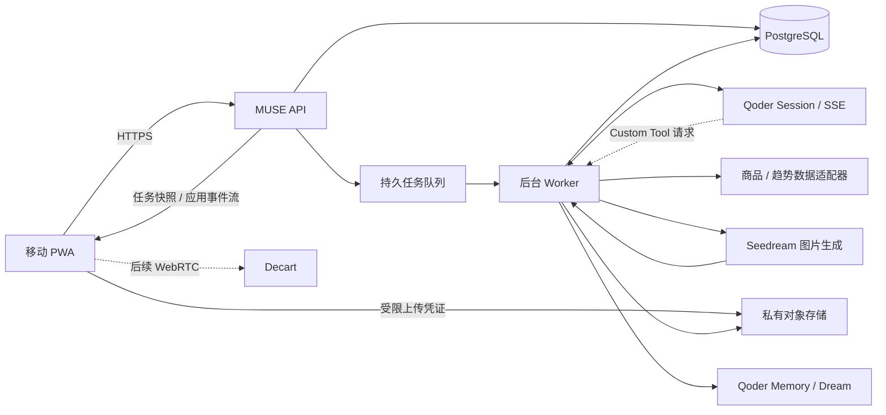
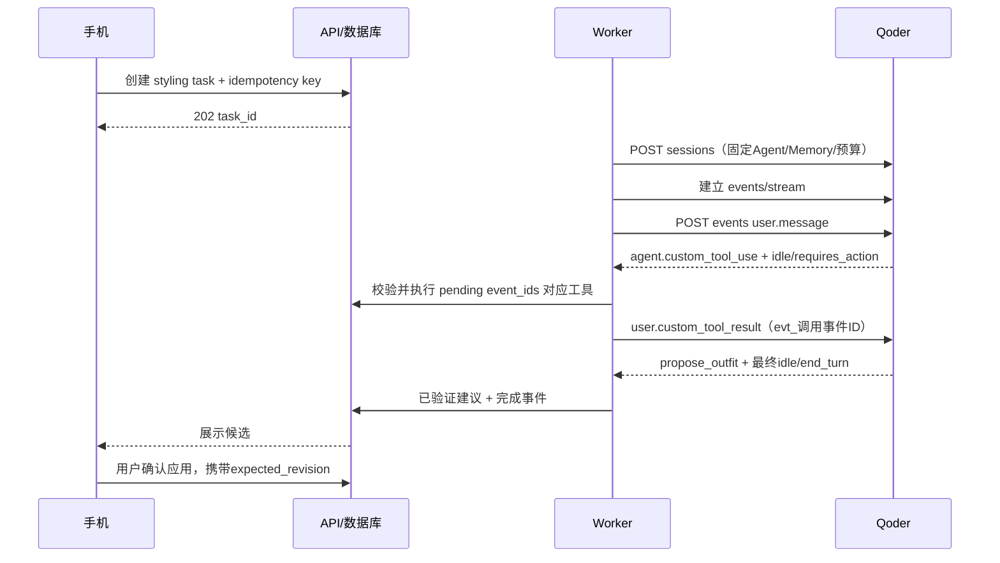

# MUSE 产品与技术规格 v1.0

状态：开发基线 / 待后端实现。更新：2026-11-16（Asia/Shanghai）。面向前端、后端、AI 接入和测试同学。

本规格取代早期 `IMPLEMENTATION_PLAN.md` 中以实时视频为首发试穿能力的安排：**首发为 Seedream 参考图图片试穿，Decart 为后续独立实时能力**。长期记忆使用 Qoder 原生 Memory / Dream，不使用 OpenViking。

## 0. 阅读和交付入口

| 文件 | 用途 |
|---|---|
| 本文 | 产品范围、状态、架构、数据、流程、上线与验收的共同基线 |
| [API 契约](contracts/openapi.json) | MUSE 自有 API，OpenAPI 3.1；待实现，不是现成服务 |
| [团队开发说明](TEAM_HANDOFF.md) | 分工、启动、配置、联调、完成标准 |
| [Qoder 接入 skill](../skills/qoder-cloud-agent/SKILL.md) | 可复制给同学的独立 skill，附协议、请求样例与调用脚本 |
| [Seedream 试穿](SEEDREAM_TRYON.md) | 模型输入、任务状态、存储、质量验收、失败处理 |
| [协议参考](../server/reference/README.md) | 离线验证的 Qoder 适配器；不等于已实现业务后端 |
| [场景搭配](SCENE_OUTFITS.md) | 本次三个场景的前端实现和兼容策略 |

### 已有与待建

- 已有：React / TypeScript / Vite / Lenso 手机原型；今日、衣橱、搭配画布、灵感、商品推荐示例、试穿示例；本地存储；公开 Sites 预览。
- 已有：Qoder HTTP / SSE 协议参考及离线测试。新增 skill 的请求预览不需要凭据；真实调用由开发者明确执行。
- 待建：业务登录、数据库、图片上传与识别、后台队列、Qoder 云资源联调、Memory/Dream 实际运行、商品源、Seedream 真实试穿。
- 暂不交付：支付下单、自动购买、社交社区、全自动尺码承诺、Decart 实时视频正式接通。
- 文中“必须 / 应”表示团队实现要求；“示例 / 目标”不表示云服务已测过或有 SLA。

## 1. 产品目标与核心行为

帮助用户从自己拥有的衣服出发，决定今天穿什么，探索风格，并在有明确缺口时判断新衣服是否值得买。

第一版核心闭环：**今日搭配 → 自由替换 / AI 建议 → 图片试穿 → 保存或记录真实反馈 → 下一次推荐更了解用户**。衣橱是事实来源，灵感是可选入口，购买建议是补充决策。

| 模块 | 输入 | 输出 / 主要动作 | 空态与失败 |
|---|---|---|---|
| 今日 | 场景、每场景草稿、已有衣物 | 显示整套；点单件换衣；整套编辑；保存 | 新用户提供明确标记的示例或引导加衣；不冒充已有 |
| 衣橱 | 相册 / 拍照 / 合法商品来源 | 用户确认的衣物卡片、分类、收藏 | 识别失败保留原图并允许手填；抠图不是添加前置条件 |
| AI 搭配 | 草稿版本、场合、偏好、锁定单品 | 有真实衣物引用的候选与理由 | 信息不足询问；无合适组合可明确返回无建议 |
| 灵感 | 用户主动浏览的风格 / 季节资料 | 收藏；尝试用自己的衣服搭出类似感觉 | 热度信息必须有来源与日期；示例专题明确标记 |
| 购买建议 | 预算、候选商品、已有衣橱 | 新增花费、可复用单品、完整组合、购买链接 | 库存 / 尺码表未知就显示未知；不伪造价格 |
| 图片试穿 | 本人照片、确定版本的服装参考图 | 一张生成效果图，可重新生成 / 保存 | 不更改原搭配；错误时展示明确重试入口 |
| 我的与反馈 | 保存记录、真实穿过及感受 | 历史搭配、偏好管理、删除 | 收藏 / 试穿预览 / 实际穿过分开记 |

### 今日三个场景的确定规则

三个入口为“轻松日常 / 周末漫步 / 见面时刻”。首次进入每个场景载入不同的示例组合。切换后记住该场景最后一次编辑，返回时恢复。只有用户点击“恢复场景推荐”才丢弃该场景的手动草稿；已保存历史不删除。原型推荐是确定性示例，不称为刚由 AI 生成。

整套编辑使用临时草稿：取消不写回，应用一次性写回；单件替换直接写回当前场景。排版、锁定、草稿版本均属于具体场景，不跨场景覆盖。删除衣物后检查所有草稿引用，展示缺失位置，不静默换成另一件。保存历史保留当时快照，原图删除按隐私策略同步失效。

## 2. 技术决策

| 层 | v1 选择 | 理由与边界 |
|---|---|---|
| 客户端 | 现有 React + TypeScript + Vite + Lenso，PWA 基础 | 保留工程；移动浏览器和主屏幕入口；不保证离线 AI |
| 业务 API | Node.js 22 LTS + TypeScript + Fastify | 一个服务处理身份、业务 CRUD、任务提交和事件流 |
| Worker | 同仓库独立 Node 进程 | AI 任务不依赖手机长连接或页面生命周期 |
| 存储 | PostgreSQL + 私有 S3 兼容对象存储（可用 TOS/OSS） | DB 存事实和状态，对象存储放原图、抠图、试穿结果 |
| 队列 | 初期 PostgreSQL 任务表 + lease + SKIP LOCKED | 小规模团队避免同时维护 Redis；后续可替换队列实现 |
| AI 编排 | Qoder Cloud Agents Managed API | 固定版本 Agent；每任务 Session；Custom Tools 执行业务逻辑 |
| 记忆 | 每用户 Memory Store，Dream 后台整理 | DB 仍是精确事实源；Store ID 保存在 DB |
| 图片试穿 | Seedream images/generations，默认单图输出 | 人物图 + 单品图，不经过 Agent 转发图片字节 |
| 实时试穿 | Decart，后续可选 | WebRTC 视频与图片生成独立实现和计费 |



### 为什么保留业务后端

Qoder Environment 是 Agent 执行环境，不是 MUSE 网站托管服务器。Custom Tools 的“client-side”指 Qoder 调用方；在本项目中调用方是 Worker。数据库密钥、商品凭据和 Ark API Key 不注入 Agent 环境，也不交给手机。

普通换衣与保存由前端 / API 处理，不触发模型费用；首屏读取已有结果。用户主动请求“帮我搭”才提交 AI 任务。Seedream 试穿直接是独立图片任务，无须先让 Agent 决定是否调用模型。

## 3. 手机使用与部署拓扑

### 原型站

公开预览：<https://muse-mobile-wardrobe.gentle-dell-0151.chatgpt.site>。任何人可打开；当前数据仅保存在各自浏览器，不跨设备同步。公开访问前端不意味着公开读写未来个人数据库。

### 可交付的 v1 部署

在自有 HTTPS 域名部署前端 + `/api/v1/*` 同源反向代理；一台应用服务器运行网关、API、Worker；PostgreSQL 与对象存储使用独立持久资源。静态 Sites 预览保留为演示环境。它不会自动部署 Node Worker 或 PostgreSQL。

如果决定继续用 Sites 承载正式服务，需另做 Cloudflare Workers / 外部 Worker 的部署设计、跨域及身份桥接，不可把此 Node 长任务架构直接当作 Sites 内置能力。Sites 宿主认证与自有域名的业务认证是两个部署选项，不混写一套 session。

团队基线选择自有域名同源 API；登录使用标准 OIDC 服务端 code flow + PKCE，API 维护 HttpOnly / Secure / SameSite=Lax cookie，服务端校验 issuer / audience / state / nonce。身份服务供应商是部署前需团队确定的依赖。开发可注入固定测试身份，生产禁止启用。写请求检查 Origin / CSRF；服务端查询始终约束 owner。

手机 Safari / Chrome 访问 HTTPS 地址 → 添加到主屏幕。桌面保留手机框演示。答辩使用手机投屏；手机 `localhost` 不是电脑的地址。局域网 HTTP 只用于普通页面测试，相机验证使用 HTTPS。PWA manifest 与图标不等于离线缓存；v1 不缓存私人 API、授权 URL 或照片。

环境区分 dev / staging / prod：独立数据库、bucket、Qoder 资源与凭据、Ark 配额。正式站不得默认加载真实用户照片作为所有访客的示例。

## 4. 领域模型与数据约束

以下为规范数据模型，不是已部署迁移。内部 ID 使用 UUID；Qoder ID 为不透明字符串；时间为 UTC ISO 8601；显示按用户时区；金额用整数“分”+ currency，禁止浮点加总。

| 表 / 聚合 | 核心字段 | 约束 |
|---|---|---|
| users | id, identity_subject, timezone, created_at | identity_subject 唯一；用户可删除账户 |
| media_assets | id, owner_id, kind, object_key, mime, bytes, sha256, status, expires_at | 私有；status=uploading/ready/deleting/deleted；生成输入只能引用 ready |
| garments | id, owner_id, name, category, color, material, image_asset_id, measurements, source, revision, deleted_at | category=coat/top/bottom/shoes/bag；后续可扩展；拥有状态需用户确认 |
| outfit_drafts | id, owner_id, scene, revision, slots, canvas_layout, updated_at | 每用户每场景一个活动草稿；slots 含 source/asset/ref ID；revision 乐观锁 |
| outfit_versions | id, owner_id, draft_id, source_revision, snapshot, worn_date | 不可变快照；同一次保存幂等 |
| tasks | id, owner_id, type, status, stage, progress, input_snapshot, result, error, cancel_requested_at, lease_until, attempt | type=styling/tryon/garment_extract/account_deletion；真实进度未知时 progress=null |
| task_events | task_id, seq, type, payload, created_at | 唯一(task_id,seq)，由服务端递增；用于手机补事件 |
| idempotency_records | owner_id, route, key, request_hash, response, expires_at | 同 key 同 payload 返回原结果；不同 payload 返回 409 |
| agent_sessions | task_id, owner_id, qoder_session_id, agent_version, memory_store_id, cursor | qoder_session_id 唯一；同任务补问复用；活跃 turn 单飞 |
| agent_events | session_id, event_id, payload, processed_at | 唯一(session_id,event_id)，只持久化完整 buffered 事件 |
| tool_calls | session_id, call_event_id, owner_id, name, input, result, state, lease_until | 唯一(session_id,call_event_id)；状态 claimed/executed/return_pending/returned |
| product_variants | provider, external_id, sku_id, title, image, price_fen, currency, available, fetched_at, source_url | 商品和已有衣物分开；价格是有时间的快照 |
| recommendations | task_id, product_refs, wardrobe_revision, combinations, evidence | 保存计算规则版本、去重后组合和来源 |
| wear_feedback | id, owner_id, outfit_version_id, actually_worn, fit_by_part, comment, consent_to_memory | 原始记录优先；模型不能改写用户原话 |
| memory_bindings | owner_id, workspace_key, active_store_id, generation, last_feedback_seq | owner 独立；Store 提升用 generation 比较更新 |
| memory_sync_jobs | feedback_id, store_generation, state | 唯一(feedback_id,store_generation)；可重放且不重复偏好 |
| dream_jobs | id, owner_id, input_store_id, input_generation, session_ids, provider_id, status, output_store_id | 保存反馈水位；队列按上游身份/工作空间串行 |
| usage_ledger | owner_id, task_id, provider, operation_id, reserved, settled, unit | operation_id 唯一；Qoder credits 与 Ark 图片/金额分别记 |

slots 示意：

```json
{
  "top": {"source":"wardrobe","ref_id":"uuid","asset_id":"uuid","locked":false},
  "bottom": {"source":"product","ref_id":"uuid","asset_id":"uuid","locked":false}
}
```

购买建议中new_cost_fen仅在所有待购价都已知时给总额；否则为null并返回cost_complete=false、known_subtotal_fen及未知项，不把未知价格视为免费。

source=product 不计入“已拥有”。保存搭配允许含待购商品但明显标识；用户确认购买并收到后才转换为衣橱衣物。试穿固定 snapshot，不引用随后可变的 draft 当前值。

measurements 用 `{value, unit, measurement_type, source}`；measurement_type 区分人体围度、服装平铺半围、服装整围。未知值为 null，不能拿“胸宽 50”直接与人体胸围 90 比较。尺码计算由代码处理单位和松量，数据不足返回 needs_information。

## 5. API 公共约定

API 基础前缀 `/api/v1`。完整字段见 [openapi.json](contracts/openapi.json)。此文件是开发合同，不表示路由已运行。

- 登录 cookie 鉴权；匿名只可访问公开能力说明、风格编辑内容和示例。私有资源越权返回 404。
- GET /me 返回 session 绑定的 csrf_token；POST/PATCH/DELETE 携带 X-CSRF-Token，服务端同时校验 Origin。OIDC 回调由 state/nonce/PKCE 防护。
- JSON 字段 snake_case；客户端发送记录 ID，不发送 owner_id 或上游凭据。
- 创建任务和保存操作要求 `Idempotency-Key`；记录至少保留 24 小时（项目策略）。重复提交只创建一次业务操作。
- 修改草稿 / 衣物携带 expected_revision，冲突返回 409 + current_revision；客户端提供重载/重新应用选择，不静默覆盖。
- 成功对象直接返回；列表 `{data,next_cursor}`；错误 `{error:{code,message,retryable,request_id,details?}}`。错误文案不能包含密钥、签名 URL 或全量照片内容。
- 请求体默认上限 256 KB；照片不走 JSON API，而走预签名上传。单图客户端上限 10 MB、长边目标 2048px（本项目策略，低于上游上限）。
- 任务创建返回 202 `{task_id,status}`，手机随后 GET 快照并订阅 SSE。不要让手机等一次长 POST 才拿到结果。

| 路由 | 用途 |
|---|---|
| GET /capabilities | 真实能力开关：demo / configured / unavailable；不能配置假成功 |
| GET /auth/login，GET /auth/callback，POST /auth/logout | 业务 OIDC 跳转、回调和退出；与 Sites 宿主入口区分 |
| GET /me；DELETE /me | 当前用户、CSRF token与额度；异步清理账户 |
| GET/POST /garments；GET/PATCH/DELETE /garments/{id} | 用户衣物 CRUD |
| POST /media/uploads；POST /media/{id}/complete；GET/DELETE /media/{id} | 受限上传、服务端验收、刷新签名链接、删除 |
| GET /outfit-drafts/{scene}；PATCH /outfit-drafts/{scene} | 场景草稿读取和带 revision 保存 |
| GET/POST /outfits；GET/DELETE /outfits/{id}；POST /outfits/{id}/worn | 保存快照、读取/删除、确认当天穿过 |
| POST /garment-extraction-tasks | 衣物识别候选，用户确认后才创建garment |
| POST /media/{id}/retain | 显式保存自己的试穿结果，取消默认过期 |
| POST /styling-tasks | 生成 AI 搭配或购买建议 |
| POST /tryon-tasks | Seedream 图片试穿 |
| GET /tasks/{id}；GET /tasks/{id}/events；POST /tasks/{id}/cancel；POST /tasks/{id}/messages | 任务读取、流、取消、补答 |
| GET /inspirations；GET /products | 有来源的灵感和商品列表 |
| POST /wear-feedback；DELETE /wear-feedback/{id} | 原始反馈 + 记忆同步/清理意图 |
| GET /preferences；PATCH /preferences | 已确认偏好管理，带 revision |
| POST /tryon/client-token | 后续 Decart 短期凭证，默认关闭 |

### 应用 SSE（与 Qoder SSE 分开）

```text
id: 42
event: task.updated
data: {"task_id":"uuid","status":"running","stage":"reading_wardrobe","progress":null}

id: 43
event: outfit.proposed
data: {"task_id":"uuid","proposal_id":"uuid","draft_revision":4}
```

`seq` 为应用事件游标，不是 Qoder evt_。GET 快照返回 last_event_seq；流从该游标后续传。断线重连、手机切后台后先补快照；过期游标触发重新取快照。服务器先落数据库再发事件。心跳每 15 秒，代理关闭缓冲；不向 UI 转发模型内部思考或完整工具原始数据。

## 6. Qoder 集成规格

使用 Managed API，CN 基址 `https://api.qoder.com.cn/api/v1/cloud`。开发 PAT，生产服务账号 SA Key 换 SAT；长期凭据只保存在服务端。官方 `qca-sdk` 使用 `ManagedClient`，Node >=20.12；项目运行 Node22。注意 SDK 默认区域，显式配置 CN。完整流程与脚本见 [skill](../skills/qoder-cloud-agent/SKILL.md)。

资源关系：一个版本化穿搭 Agent + Environment 配置可复用；每用户独立 Memory；每次独立业务任务一个 Session；同任务后续补问复用 Session。Agent version 必须固定，模型用当前 `/models` 返回值。角色、预算、工具集合变化时建立新版本，不影响正在执行的 Session。

### 工具合同

| 工具 | 参数 | 返回 | 执行者 |
|---|---|---|---|
| read_wardrobe | 可选 category | 衣物 ID、名称、属性、缺失项 | Worker，owner 取自 task |
| propose_outfit | garment_ids, reason | 经校验的 outfit_proposal | Worker 保存建议；用户应用才改草稿 |
| search_products（阶段二） | query, category, max_price_fen | 有实际来源的商品快照 | 商品适配器，搜索不发送身体信息 |
| get_product_details（阶段二） | product_id, sku_id | 图片、价、库存、尺码、来源时间 | 商品适配器 |
| evaluate_purchase（阶段二） | product_id, draft_id | 成本、可搭单品、完整组合与未知项 | 规则引擎 |
| calculate_fit（阶段二） | product_id, measurement_profile_id | size_candidates / needs_information + evidence | 规则引擎，不看生成图测尺码 |

内置工具首期只允许 Read 读取挂载的个人记忆。不要把 `enabled_tools: []` 当作关闭：当前契约下这代表全开；不需要内置工具时省略整项。Custom Tools 必须在 Worker 中做 JSON Schema 校验、权限检查、资源归属检查和费用检查；提示词不能替代这些检查。



`propose_outfit`参考实现返回内部outfit_candidate，不是可直接发给手机的OutfitProposal。Worker先校验类别、锁定位置、去重、owner与快照revision，在事务中生成proposal_id并持久化，再补齐draft_revision和公共schema字段；返回过程不能信任模型生成的业务ID。

### 状态机与恢复

应用任务状态：queued → running → waiting_tools → running → succeeded；也可 needs_input / failed / cancelled / unconfirmed。cancel_requested 是取消意图，终态要根据实际执行确认。Worker 状态和手机连接状态独立。

needs_input 返回 Task.question；POST /tasks/{id}/messages 携带 Idempotency-Key 接收补答，复用本任务Session且回到queued。只有needs_input允许补答；活跃turn、终态和草稿版本冲突返回409。Agent自然语言提问必须经业务分类后才能标记needs_input，不能仅凭idle推断。

server/reference 的 taskState 返回内部协议信号：waiting_for_tools映射waiting_tools，recovering映射running+stage=recovering，turn_ended需候选/取消判定后才给应用终态，terminated按取消或错误映射，unknown先恢复对账。内部信号不能原样作为公共Task.status。

Qoder 的 session.status_idle 不是一律成功：requires_action 表示等工具；end_turn 也需检查本地取消标记和已验证结果；其他原因映射成错误或待处理。agent.message、thread_idle、SSE EOF 都不是成功信号。

首次 SSE 不带 Last-Event-ID 从尾部开始，不重放历史：先订阅成功再发送消息。恢复已有 Session 时补读历史（按 next_page 分页）并接续流；完整事件按 ID 去重，业务副作用按调用 ID 去重。首期不启用 event_deltas，后续启用时 start/delta/final 可能共用 ID，不能把它们一并去掉。

工具执行：数据库领取租约 → 执行 → 持久化结果 → 回传。返回请求超时不能重新执行业务；先查是否已有相同 custom_tool_use_id 的结果，再决定回传。对于创建 Session 响应丢失：标为 unconfirmed，按任务 metadata 和可用历史核对，不能盲建第二个。只在目标接口明确支持时用上游 Idempotency-Key，应用自己的键不能自动保证上游幂等。

手机取消：先写 cancel_requested_at，再 POST Qoder sessions/{id}/cancel；关闭 SSE 不等于取消云执行。Worker 重启时领取过期租约，先对账再运行；未知状态保留为未知，不能伪报成功。

## 7. Memory 与 Dream

Memory 保存确认过的偏好与经验，数据库保存事实和原始记录。推荐 Session 默认只读挂载该用户 Store。Memory未开启时省略resources，衣橱搭配仍可运行，不以Memory配置阻塞最小闭环。后端把用户明确确认的反馈按路径去重写入，例如 `wear-feedback/{feedback_id}.md`；聚合偏好文件保留 provenance 和 updated_at。

创建 Memory Store 后，可写初始 `preferences/profile.md`；没有内容时允许空档案，不能臆测偏好。更新 Memory 使用 POST，并带上读到的 content_sha256；409 重新读取并按原始事实合并。Memory 列表不含完整 content，需取单项。

Dream 不在实时请求里跑。触发策略为“有新确认反馈时每日批处理”（项目默认，可配置）。显式传同一用户的 Store 与 1–100 个已完成 Session，避免空列表扩大回顾范围。输出是新 Store 副本：

1. 记录 input_store_id、generation、反馈水位。
2. 创建 Dream，保存 drm_ ID 后轮询至终态。
3. 校验输出、归属与来源；补齐任务期间新增反馈和删除 tombstone。
4. 用 generation 比较更新用户 active_store_id；若版本冲突则重新对账，不覆盖。
5. 下一次新 Session 使用新 Store；旧 Session 不自动更换挂载。

同一身份/工作空间的活跃 Dream 有并发限制，队列串行。显式 session_ids 是输入范围，不可宣称它替代平台隔离；上线前必须测试 Dream 的会话回顾边界。若共享凭据仍可能读到别的用户上下文，暂停生产 Dream，使用独立业务空间/服务账号隔离后再启用。Memory 正常读写可先上线。

删除账户先创建account_deletion任务并冻结新写入，清理业务记录、对象存储和平台记忆/副本。保留仅能查询本人删除任务的短期受限会话，完成后撤销；删除失败显示待处理状态并由后台重试可幂等步骤。任务审计只留脱敏ID与错误码。

删除偏好需要清理当前 Store、历史版本/副本及原始业务记录的相关内容，并处理进行中的 Dream；单纯从前端移除一行无效。用户照片不写 Memory。

## 8. Seedream 图片试穿

首期方案是**人物图 + 选定单品参考图 → 一张外观预览**。优先验证上装单件与上装/下装组合，再开放复杂叠穿；这属于质量验收范围，不改变接口支持多参考图的事实。

官方当前多图接口支持 Seedream 5.5，示例 Model ID 为 `doubao-seedream-5-5-261028`。项目通过 `ARK_IMAGE_MODEL` 配置实际已开通 Model ID 或 Endpoint ID；正式启用前验证账户权限、效果和价格，不自动开通付费资源。5.5 最多10张参考图，项目 v1 限制为1张人物＋最多5张单品图。

上游 `POST https://ark.cn-beijing.volces.com/api/v3/images/generations` 是图片请求；**我们自己的 API 才返回 task_id**。不得臆造 Seedream jobs 查询接口。输入与输出详细合同见 [SEEDREAM_TRYON.md](SEEDREAM_TRYON.md)。

角色分离：Qoder 组织搭配和解释，Worker 固定图序与提示词版本，Seedream 生成，用户判断是否喜欢。生成结果不回流为“真实穿过/尺码合适”的事实。

## 9. 衣物录入、推荐与尺码

上传先生成私有 asset_id 和受限上传 URL；对象 key 由服务端生成。完成回调后验证实际 MIME、大小、解码尺寸、SHA256、归属，清理 EXIF；有效后才变 ready。识别/抠图作为异步任务，输出候选属性，用户确认后保存 garments。v1 可手动录入，不把识别供应商尚未确定作为衣橱 CRUD 的阻塞。

商品适配器输出统一 ProductVariant；只接一个经授权的数据源作为首期。URL 输入只解析允许的电商域名，禁用任意 URL 抓取；短链解析也需每跳校验，防止 SSRF。价格和库存按打开商品/购买跳转前刷新，过期快照不假称实时。

“能搭几件”与“几套”分别计算：匹配单品数=去重后的已拥有单品；完整套数=满足品类/场景约束且经规则评分的完整组合去重数。展示实际组合列表及截断上限；锁定单品优先保留。预算以新增商品去重后的 SKU 成本计，已拥有成本为0，运费/优惠未知时单列说明。

风格推荐可使用编辑内容作为冷启动；季节趋势使用带日期和出处的内容，过期时只称风格参考。初期无需独立向量数据库；确有大规模检索需求再增加检索层。

尺码只依据身体测量、参考衣物、商品尺码表、材质与真实反馈。输出包括推荐范围、依据、缺失字段和风险，不输出未经校准的“95%合身”。

## 10. 隐私、成本与可观测性

- 公共示例与私人图片分桶/路径；有签名的图片链接不入日志或 Memory。用户主动确认后才将其照片发送到 Seedream，界面说明用途、供应商和保存范围。
- 照片删除：本方对象、衍生结果、引用和正在排队任务一并处理；供应商侧保留遵循真实协议，不能承诺未经确认的立即全平台删除。
- 项目默认保留策略（可调）：未确认上传24小时清理；临时人物照片24小时清理；未收藏结果7天；用户主动保存的结果保留到删除。建立清理任务与审计记录。
- 限流：应用用户、IP、供应商三层；任务创建先预留额度，完成按真实 usage 结算，失败与不确定状态按对账结果释放/冻结。禁止无限自动生成。
- Qoder 配每 Session credit 上限；Ark 单任务默认1张输出。费用 UI 只用真实配置价格与账户策略，不把示例数字当收费标准。
- 每任务记录 trace_id、上游 request_id、阶段耗时、调用次数、结果字节和错误码；日志不包含密钥、完整提示词中的隐私或图片。
- 监控：队列年龄、任务成功率、SSE恢复率、重复调用拦截数、生成首结果耗时、成本/成功任务、Memory同步积压、Dream冲突。

## 11. 测试与验收

| ID | 场景 | 验收 |
|---|---|---|
| F01 | 三场景切换、自由换衣 | 三套确实不同；每场景草稿/排版独立；刷新保持 |
| F02 | 整套选衣关闭 / 应用 | 关闭不改首页；应用只改当前场景 |
| F03 | 老版本本地记录 | 升级保留衣橱、收藏、已保存搭配，不全量重置 |
| B01 | 两账号互读 ID | 衣服、草稿、照片、任务、Memory均不可串读 |
| B02 | 同键重复创建 / 不同body | 同body同任务；不同body返回409；不重复费用 |
| B03 | revision冲突 | 不覆盖对方修改；用户可重新应用 |
| Q01 | 模型工具引用不存在衣服 | 拒绝候选，返回可恢复工具错误 |
| Q02 | SSE断流、手机后台、Worker重启 | 补历史/快照，不重复执行工具，不误报完成 |
| Q03 | 工具回传响应丢失 | 对账已回传记录，不重新执行业务 |
| Q04 | end_turn无有效候选 / 已取消 | 不显示成功搭配 |
| M01 | Dream运行时新增/删除偏好 | 提升副本前回放变更；不复活已删除内容 |
| M02 | Dream租户隔离 | 无跨用户检索；不通过则禁用生产Dream |
| I01 | Seedream基础换装 | 人物身份、衣服颜色/图案、遮挡和四肢由人工盲评 |
| I02 | HTTP200含error/空data/下载失败 | 不标成功；提示失败或保存中；禁止重复计费重试 |
| I03 | 生成中改搭配 | 结果对应原snapshot，并提示不是当前草稿 |
| I04 | 取消 / 删除照片 | 不承诺上游已停止；晚到结果按取消/删除策略清理 |
| P01 | 实体iPhone/Android | HTTPS、主屏幕、上传、键盘、后台恢复、安全区正常 |

性能目标（待实测）：普通换衣交互100ms内可见；普通API p95<500ms（不含图片上传/上游AI）；AI任务提交1秒内返回task_id；首个任务状态2秒内可见。图片生成耗时不预设服务保证，记录至少30个有授权的代表样本，报告成功率、p50/p95、细节保真和真实成本后确定UI文案及套餐。

CI 必跑：类型检查、生产构建、协议/状态/越权/幂等测试、OpenAPI引用校验。真人图片不进入测试仓库；使用许可素材或合成测试数据。

## 12. 研发分工与里程碑

| 阶段 | 负责人角色 | 交付 | 可并行条件 |
|---|---|---|---|
| A 接口基线 | 全员+后端 | 确认OpenAPI、ID/错误/事件约定，mock server | 当前即可开始 |
| B 业务底座 | 后端 | 登录、media、garments、draft/outfit、任务表 | 前端按契约mock继续 |
| C Agent | AI/后端 | 两个Custom Tools、SSE恢复、Session预算 | B具备真实衣橱即可联调 |
| D 图片试穿 | AI/后端+前端 | Seedream任务、上传、结果保存、失败恢复 | 使用独立mock任务先接UI |
| E 偏好 | AI/后端 | Memory同步、Dream队列与隔离验收 | 不阻塞C的无记忆搭配 |
| F 购买 | 商品同学 | 一个授权商品源、预算与可复用组合 | 依赖真实衣橱；无需等待Decart |
| G 发布 | 全员 | staging真机验证、配额/日志/备份、生产 | 所有高优先级验收通过 |

每个PR写清关联接口、状态迁移、异常处理、验证方式；接口变更先更新OpenAPI及样例。不要每个同学单独修改App全局状态。配置说明、开发入口与分工提示见 [TEAM_HANDOFF.md](TEAM_HANDOFF.md)。

## 13. 上线前待定项

必须由实测/供应商确认：业务身份提供方、云部署账号与域名、Qoder可用模型和实际延迟/成本、Dream隔离边界、Ark已开通模型/区域/真实试穿质量、照片处理与留存政策、商品数据授权与覆盖率。上述是外部依赖，不把它们伪装成已经完成的能力。

文档核对来源：Qoder [Managed API概览](https://docs.qoder.cn/cloud-agents/api-overview)、[创建Session](https://docs.qoder.cn/cloud-agents/sessions-create)、[工具](https://docs.qoder.cn/cloud-agents/agent-tools)、[事件发送](https://docs.qoder.cn/cloud-agents/api/sessions/events/send)、[SSE](https://docs.qoder.cn/cloud-agents/api/sessions/events/stream)、[初始连接变更](https://docs.qoder.cn/cloud-agents/sse-initial-connection-behavior-change)、[Memory](https://docs.qoder.cn/cloud-agents/memory-stores)、[Dream](https://docs.qoder.cn/cloud-agents/dreams)、[认证](https://docs.qoder.cn/cloud-agents/api-authentication)、[SDK](https://docs.qoder.cn/cloud-agents/sdk/typescript)；火山方舟 [图片生成API](https://console.volcengine.com/ark/region:cn-beijing/docs/image-generation-api)、[图片生成教程](https://console.volcengine.com/ark/region:cn-beijing/docs/image-generation-tutorial)。
